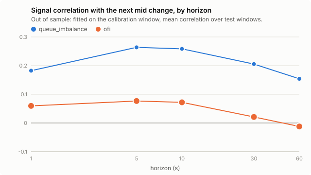

# lobreplay — Avellaneda–Stoikov on real order book data

Replays NASDAQ order-by-order data (LOBSTER) to test the Avellaneda–Stoikov
(2008) market-making formula against real order flow. The formula says what
buy and sell prices a market maker should quote. This project posts those
prices on a real trading day, works out which of them would have traded, and
compares the outcome with what the formula's own assumptions predict.

## Results

One trading day (21 June 2012), five NASDAQ stocks, 2,110,860 order book
messages. Calibrated and fitted on 09:31–12:45, tested on 12:45–15:59.
Brackets are 95% bootstrap intervals over six 30-minute windows. Full tables
are in `results/<TICKER>/report.md`, which `study` writes. `results/` is in
`.gitignore`, so the chart below shows only after `study` has been run, or
if `results/` is taken out of `.gitignore` and committed.

**1. The model's "a fill tells you nothing" assumption fails on real fills.**
Five seconds after one of our fills the mid price had moved against us, in
every stock. The model assumes zero.

| stock | spread | markout at 5 s (ticks per share) | fills behind it |
|---|---|---|---|
| AAPL | 17 ticks | −4.5 [−6.8, −2.2] | 142 |
| AMZN | 14 ticks | −7.9 [−11.4, −4.2] | 17 |
| GOOG | 31 ticks | −4.9 [−7.1, −1.8] | 14 |
| MSFT | 1 tick | −0.8 [−1.0, −0.5] | 4 |
| INTC | 1 tick | −0.75 [−1.5, 0.0], not established | 4 |

Inventory strategy, middle risk setting, conservative fill rule. The first
four hold under the optimistic rule too.

**2. The calibrated model overstates fills and profit.** In AAPL the replay
made $148 per window [24, 260] where the model world, with the same σ, A and
k, made $710; it got 24 fills per window where the model expected 49. In the
two one-tick-spread stocks the gap is far larger: under one fill per window
against 22 expected, because the model's spread is wider than the market's
and its quotes sit behind the best price. Part of this gap is the calibration
method and not the model; see limitation 12.

Every fill is booked at its own price. The $148 values the shares still held
when a window closes at the middle price, which no one can trade at. The
report therefore gives the profit three ways (AAPL, per window):

| how leftover shares are treated | profit |
|---|---|
| Not counted: completed buy-and-sell pairs only | $110 [9, 218] |
| Valued at the middle price | $148 [24, 260] |
| Traded out against the real book at the close | $137 [15, 245] |
| The model's forecast | $710 |

About 127 shares were left at a typical close, out of 2,220 traded per
window. In AMZN and GOOG the completed pairs made $2 to $5 per window and
closing the leftover at real prices takes the total to −$13 and +$3: nothing
distinguishable from zero.

**3. Queue imbalance predicts the next move in one-tick-spread stocks, out of
sample.** A line fitted in the morning, scored in the afternoon, on the mid
change over the next 5 seconds:

| stock | correlation | direction called |
|---|---|---|
| MSFT | 0.26 [0.25, 0.28] | 73% of 1,987 moves |
| INTC | 0.23 [0.19, 0.30] | 77% of 1,264 moves |
| AAPL, AMZN, GOOG | 0.04 to 0.06 | 54% to 57% |

This matches what was written down beforehand: stronger where the spread is
one tick. Order flow imbalance and trade imbalance were weaker than expected,
0.06 to 0.12 at best.

**4. The paper's "volatility is constant" assumption was off by a quarter.**
The paper fixes σ for the whole session. Measured the same way in both
halves of the day, afternoon volatility was 24% to 32% below the morning's
in all five stocks. The study still uses the morning's σ all afternoon,
because that is the model being tested. This comparison was made with a
separate script; the `study` report prints the morning figure only.

**What did not come out.**
- Leaning the quotes on the signal (Q8) showed no measurable gain in markout
  or P&L in any stock. A null result.
- The value of queue position (Q4) is not established. In AAPL and AMZN it
  is large under the optimistic fill rule and absent under the conservative
  one, which by this study's own rule is not a conclusion. In INTC and MSFT
  the strategy traded too rarely to say anything.
- One day per stock. Nothing here shows the numbers hold on another day.

### How far the replay can be trusted

| check | result |
|---|---|
| Book rebuilt from messages against the exchange's book, after every message | zero divergences, 2,110,860 messages, 5 stocks |
| Levels taken from the orderbook file instead (see below) | 42,855, about 2% of messages |
| Real orders shadowed: did we predict the message at which each finished filling? | 71,289 of 72,615 (98.2%) |
| ...per stock | AAPL 99.4%, AMZN 99.4%, GOOG 99.7%, INTC 97.3%, MSFT 97.5% |
| ...every fill at the same message and size | 71,113 of 72,615 (97.9%) |
| Mismatches with no cause tag | 58 (AAPL 3, GOOG 1, INTC 25, MSFT 29) |

The message file leaves out events beyond the tenth price level, so a level
that rises into the top ten from outside cannot be rebuilt from messages and
is taken from the orderbook file. Levels already in view are never taken from
it. `docs/DATA_FORMAT.md` has the details.

Shadow mismatches are tagged with a cause seen in the data: mostly an order
behind us trading while others were still ahead, and levels that had been
out of view. The 58 untagged ones are cases where, with nothing ahead of the
shadowed order, an order that arrived later traded first. A tag for that
(`later_order_traded_first`) is defined in `shadow.py`, but the check that
assigns it is not in the code at present, so `shadow` ends "UNEXPLAINED
MISMATCHES" for four of the five stocks and exits non-zero. The match rates
do not depend on the tags.

