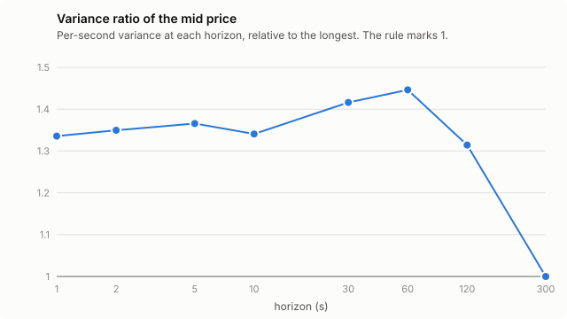
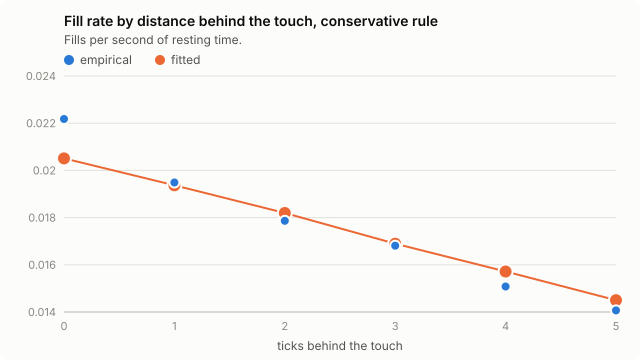
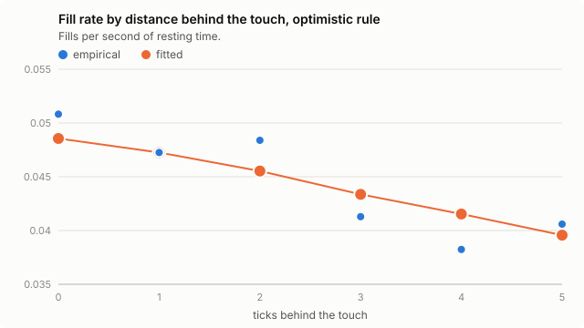
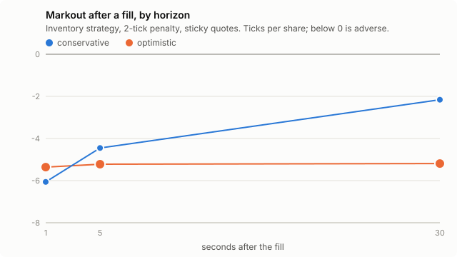
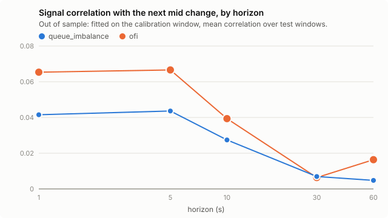

# AAPL 2012-06-21: Avellaneda-Stoikov replay study

- Calibrated on 09:31:00 to 12:45:00; traded on 12:45:00 to 15:59:00.
- Windows of 1800 s, each an independent session. Requote every 1 s and after each fill. One lot = 100 shares per side.
- Figures are means over windows with a 95% bootstrap interval in brackets. A difference whose interval contains zero is not claimed.
- P&L is in dollars per window, before fees and rebates. Markouts are in ticks per share.

## Headline

Middle settings only; every setting is in the tables below.

- **Adverse selection.** 5 s after a fill, the mid had moved by conservative -4.451 ticks [-6.805, -2.215]; optimistic -5.219 ticks [-6.699, -3.937] per share (negative is against us). Across fill rules: holds under both rules.
- **Model against replay.** conservative: replay 147.680 [24.467, 259.630] against the model's 710.240 [650.676, 770.232] dollars per window (replay below model); optimistic: replay 583.303 [264.792, 977.118] against the model's 2219.701 [2128.067, 2311.654] dollars per window (replay below model).
- **Prediction.** `ofi` had an out-of-sample correlation of 0.067 [0.041, 0.098] with the mid change over the next 5 s (positive). Leaning quotes on it changed the 5 s markout by conservative -0.140 ticks [-0.409, 0.058]; optimistic -0.168 ticks [-0.729, 0.505]. Across fill rules: not established under both rules: not a conclusion.

## Calibration

sigma = 0.0407452 dollars per sqrt(second), taken at the 60 s horizon.

| horizon (s) | sigma ($/sqrt s) | increments | variance ratio vs longest |
|---|---|---|---|
| 1 | 0.039159 | 11639 | 1.336 |
| 2 | 0.039361 | 5819 | 1.349 |
| 5 | 0.039597 | 2327 | 1.366 |
| 10 | 0.039231 | 1163 | 1.341 |
| 30 | 0.040321 | 387 | 1.416 |
| 60 | 0.040745 | 193 | 1.446 |
| 120 | 0.038843 | 96 | 1.314 |
| 300 | 0.033883 | 38 | 1.000 |

### Fill intensity, conservative rule

A = 0.037469 per second, k = 6.9357 per dollar, from 4656 probes, 2814 filled, 162142 s of exposure.

| ticks behind touch | probes | fills | exposure (s) | mean delta ($) | empirical rate (/s) | fitted rate (/s) |
|---|---|---|---|---|---|---|
| 0 | 776 | 517 | 23312 | 0.0858 | 0.02218 | 0.02051 |
| 1 | 773 | 501 | 25707 | 0.0953 | 0.01949 | 0.01937 |
| 2 | 760 | 463 | 25919 | 0.1048 | 0.01786 | 0.01819 |
| 3 | 796 | 480 | 28558 | 0.1155 | 0.01681 | 0.01689 |
| 4 | 740 | 417 | 27650 | 0.1264 | 0.01508 | 0.01572 |
| 5 | 811 | 436 | 30995 | 0.1374 | 0.01407 | 0.01450 |

### Fill intensity, optimistic rule

A = 0.069429 per second, k = 4.0419 per dollar, from 4656 probes, 4220 filled, 95844 s of exposure.

| ticks behind touch | probes | fills | exposure (s) | mean delta ($) | empirical rate (/s) | fitted rate (/s) |
|---|---|---|---|---|---|---|
| 0 | 776 | 707 | 13912 | 0.0858 | 0.05082 | 0.04856 |
| 1 | 773 | 714 | 15109 | 0.0953 | 0.04726 | 0.04725 |
| 2 | 760 | 712 | 14713 | 0.1048 | 0.04839 | 0.04553 |
| 3 | 796 | 708 | 17147 | 0.1155 | 0.04129 | 0.04337 |
| 4 | 740 | 654 | 17105 | 0.1264 | 0.03824 | 0.04153 |
| 5 | 811 | 725 | 17858 | 0.1374 | 0.04060 | 0.03957 |

## Q1. Does the calibrated model predict replay P&L?

| fill rule | strategy | penalty (ticks) | replay P&L | model P&L | replay fills | model fills | verdict |
|---|---|---|---|---|---|---|---|
| conservative | inventory | 1 | 244.962 [104.720, 404.225] | 739.874 [668.556, 808.942] | 24.500 [10.667, 46.167] | 49.245 [48.315, 50.165] | replay below model |
| conservative | symmetric | 1 | 246.441 [86.612, 400.973] | 786.366 [671.650, 896.166] | 27.333 [11.000, 54.000] | 49.035 [48.090, 49.915] | replay below model |
| conservative | inventory | 2 | 147.680 [24.467, 259.630] | 710.240 [650.676, 770.232] | 23.667 [9.333, 45.500] | 48.845 [47.940, 49.750] | replay below model |
| conservative | symmetric | 2 | 167.263 [-19.632, 364.760] | 795.537 [684.812, 903.040] | 25.667 [9.167, 52.167] | 48.285 [47.355, 49.160] | replay below model |
| conservative | inventory | 4 | 122.730 [32.667, 213.537] | 701.877 [652.669, 751.270] | 22.167 [9.500, 41.833] | 47.690 [46.775, 48.585] | replay below model |
| conservative | symmetric | 4 | 270.608 [38.143, 472.832] | 793.586 [688.504, 897.189] | 22.833 [8.667, 44.667] | 46.625 [45.755, 47.480] | replay below model |
| optimistic | inventory | 1 | 689.453 [301.750, 1238.860] | 2256.793 [2148.710, 2368.354] | 30.000 [20.667, 42.167] | 91.000 [89.670, 92.390] | replay below model |
| optimistic | symmetric | 1 | 542.823 [253.333, 876.137] | 2295.496 [2139.942, 2450.423] | 28.333 [19.333, 40.167] | 90.760 [89.395, 92.160] | replay below model |
| optimistic | inventory | 2 | 583.303 [264.792, 977.118] | 2219.701 [2128.067, 2311.654] | 26.000 [18.333, 36.500] | 90.275 [88.960, 91.640] | replay below model |
| optimistic | symmetric | 2 | 699.533 [272.833, 1262.767] | 2294.076 [2136.118, 2443.009] | 28.167 [20.000, 37.500] | 89.855 [88.495, 91.245] | replay below model |
| optimistic | inventory | 4 | 682.952 [369.023, 1019.582] | 2192.738 [2120.030, 2264.638] | 32.000 [22.333, 47.167] | 89.340 [87.975, 90.730] | replay below model |
| optimistic | symmetric | 4 | 553.095 [280.000, 905.785] | 2281.936 [2124.797, 2436.404] | 30.000 [19.500, 43.500] | 88.075 [86.760, 89.425] | replay below model |

### Replay profit three ways

Every fill is booked at its own price. Shares still held when a window closes have no trade price, so the profit depends on how they are valued. Realised counts completed buy-and-sell pairs only (first in, first out). The middle column is the replay P&L used everywhere else in this report. The last column trades the leftover out against the real book at the close, level by level, which is what closing would have cost. Sticky quotes.

| run | realised | leftover valued at the mid | leftover closed at real prices | shares left at the close | shares traded per window |
|---|---|---|---|---|---|
| inventory/1t/sticky/conservative | 199.647 [67.722, 382.410] | 244.962 [104.720, 404.225] | 225.892 [94.067, 376.317] | 184 | 2320 |
| symmetric/1t/sticky/conservative | 194.782 [62.555, 320.152] | 246.441 [86.612, 400.973] | 225.185 [72.180, 374.207] | 218 | 2469 |
| inventory/2t/sticky/conservative | 109.942 [9.167, 217.862] | 147.680 [24.467, 259.630] | 137.483 [15.125, 244.887] | 127 | 2220 |
| symmetric/2t/sticky/conservative | 122.642 [3.572, 245.377] | 167.263 [-19.632, 364.760] | 142.557 [-42.555, 329.068] | 243 | 2302 |
| inventory/4t/sticky/conservative | 85.002 [22.002, 175.000] | 122.730 [32.667, 213.537] | 113.837 [23.327, 208.203] | 112 | 2060 |
| symmetric/4t/sticky/conservative | 209.740 [65.940, 347.257] | 270.608 [38.143, 472.832] | 236.135 [13.665, 430.873] | 305 | 2067 |
| inventory/1t/sticky/optimistic | 539.457 [226.000, 980.870] | 689.453 [301.750, 1238.860] | 608.032 [247.360, 1100.195] | 518 | 2984 |
| symmetric/1t/sticky/optimistic | 461.840 [198.667, 762.853] | 542.823 [253.333, 876.137] | 502.980 [229.765, 810.040] | 304 | 2804 |
| inventory/2t/sticky/optimistic | 531.965 [248.083, 899.895] | 583.303 [264.792, 977.118] | 545.305 [236.373, 928.548] | 337 | 2563 |
| symmetric/2t/sticky/optimistic | 521.588 [194.333, 954.265] | 699.533 [272.833, 1262.767] | 606.720 [234.683, 1083.427] | 572 | 2798 |
| inventory/4t/sticky/optimistic | 617.348 [344.653, 930.732] | 682.952 [369.023, 1019.582] | 641.843 [318.720, 978.038] | 351 | 3154 |
| symmetric/4t/sticky/optimistic | 473.765 [232.000, 817.128] | 553.095 [280.000, 905.785] | 531.218 [271.117, 869.225] | 223 | 2980 |
| signal/1t/sticky/conservative | 113.827 [35.348, 195.165] | 158.912 [50.471, 264.360] | 140.877 [39.052, 243.843] | 197 | 2196 |
| signal/2t/sticky/conservative | 67.170 [-4.830, 145.333] | 108.068 [3.918, 221.308] | 93.483 [-7.557, 202.055] | 163 | 2080 |
| signal/4t/sticky/conservative | 40.397 [-77.310, 149.167] | 78.777 [-51.383, 204.333] | 69.493 [-70.013, 196.463] | 113 | 1941 |
| signal/1t/sticky/optimistic | 534.540 [203.333, 1104.620] | 688.123 [165.500, 1356.120] | 584.278 [87.430, 1218.245] | 600 | 2536 |
| signal/2t/sticky/optimistic | 503.810 [272.833, 867.930] | 570.847 [288.750, 973.207] | 531.255 [265.643, 925.868] | 336 | 2602 |
| signal/4t/sticky/optimistic | 508.715 [367.167, 677.930] | 645.437 [420.292, 881.852] | 607.322 [409.577, 805.135] | 296 | 2779 |

## Q2. Adverse selection: markouts on replay fills

Negative means the mid moved against us after the fill. In the model world the expected markout is zero.

| fill rule | strategy | penalty (ticks) | horizon (s) | markout (ticks) | fills | verdict |
|---|---|---|---|---|---|---|
| conservative | inventory | 1 | 1 | -6.039 [-7.750, -4.501] | 147 | negative |
| conservative | inventory | 1 | 5 | -4.088 [-6.675, -1.739] | 147 | negative |
| conservative | inventory | 1 | 30 | -0.778 [-5.454, 2.768] | 147 | inside the interval: no claim |
| conservative | symmetric | 1 | 1 | -6.185 [-8.176, -4.494] | 164 | negative |
| conservative | symmetric | 1 | 5 | -3.216 [-6.146, -0.693] | 164 | negative |
| conservative | symmetric | 1 | 30 | 0.129 [-5.091, 5.768] | 164 | inside the interval: no claim |
| conservative | inventory | 2 | 1 | -6.060 [-7.742, -4.497] | 142 | negative |
| conservative | inventory | 2 | 5 | -4.451 [-6.805, -2.215] | 142 | negative |
| conservative | inventory | 2 | 30 | -2.160 [-6.652, 2.271] | 142 | inside the interval: no claim |
| conservative | symmetric | 2 | 1 | -6.215 [-8.358, -4.321] | 154 | negative |
| conservative | symmetric | 2 | 5 | -3.707 [-6.775, -1.026] | 154 | negative |
| conservative | symmetric | 2 | 30 | -1.565 [-8.108, 4.711] | 154 | inside the interval: no claim |
| conservative | inventory | 4 | 1 | -6.200 [-7.968, -4.882] | 133 | negative |
| conservative | inventory | 4 | 5 | -5.282 [-7.287, -2.918] | 133 | negative |
| conservative | inventory | 4 | 30 | -2.290 [-5.948, 0.585] | 133 | inside the interval: no claim |
| conservative | symmetric | 4 | 1 | -6.092 [-7.930, -4.294] | 137 | negative |
| conservative | symmetric | 4 | 5 | -3.966 [-6.856, -1.152] | 137 | negative |
| conservative | symmetric | 4 | 30 | -1.223 [-8.038, 5.409] | 137 | inside the interval: no claim |
| optimistic | inventory | 1 | 1 | -5.944 [-7.206, -4.550] | 180 | negative |
| optimistic | inventory | 1 | 5 | -5.859 [-8.300, -3.785] | 180 | negative |
| optimistic | inventory | 1 | 30 | -3.790 [-7.330, -0.999] | 180 | negative |
| optimistic | symmetric | 1 | 1 | -5.268 [-6.314, -4.103] | 170 | negative |
| optimistic | symmetric | 1 | 5 | -5.713 [-7.562, -3.919] | 170 | negative |
| optimistic | symmetric | 1 | 30 | -5.036 [-6.170, -3.681] | 170 | negative |
| optimistic | inventory | 2 | 1 | -5.359 [-6.136, -4.589] | 156 | negative |
| optimistic | inventory | 2 | 5 | -5.219 [-6.699, -3.937] | 156 | negative |
| optimistic | inventory | 2 | 30 | -5.189 [-6.907, -3.544] | 156 | negative |
| optimistic | symmetric | 2 | 1 | -5.291 [-6.250, -4.299] | 169 | negative |
| optimistic | symmetric | 2 | 5 | -5.240 [-7.482, -3.091] | 169 | negative |
| optimistic | symmetric | 2 | 30 | -4.449 [-6.519, -2.197] | 169 | negative |
| optimistic | inventory | 4 | 1 | -5.476 [-6.424, -4.493] | 192 | negative |
| optimistic | inventory | 4 | 5 | -5.520 [-6.533, -4.279] | 192 | negative |
| optimistic | inventory | 4 | 30 | -3.439 [-5.016, -2.023] | 192 | negative |
| optimistic | symmetric | 4 | 1 | -5.473 [-6.444, -4.517] | 180 | negative |
| optimistic | symmetric | 4 | 5 | -6.041 [-7.555, -4.568] | 180 | negative |
| optimistic | symmetric | 4 | 30 | -5.105 [-9.038, -0.875] | 180 | negative |

## Q3. Where the gap comes from: spread capture and inventory P&L

| fill rule | strategy | penalty (ticks) | replay spread capture | model spread capture | replay inventory P&L | model inventory P&L |
|---|---|---|---|---|---|---|
| conservative | inventory | 1 | 137.806 [52.512, 262.136] | 715.003 [701.316, 728.316] | 107.156 [48.132, 162.433] | 24.871 [-43.586, 92.749] |
| conservative | symmetric | 1 | 156.465 [56.320, 317.343] | 719.104 [705.259, 732.044] | 89.976 [-80.628, 268.199] | 67.262 [-45.175, 178.511] |
| conservative | inventory | 2 | 125.392 [43.474, 235.303] | 710.589 [697.202, 723.737] | 22.288 [-52.718, 97.436] | -0.349 [-58.858, 56.391] |
| conservative | symmetric | 2 | 147.340 [44.185, 309.180] | 719.905 [706.107, 732.981] | 19.923 [-248.300, 256.693] | 75.631 [-32.049, 183.665] |
| conservative | inventory | 4 | 116.901 [44.766, 212.272] | 695.146 [681.910, 708.166] | 5.829 [-141.860, 126.183] | 6.730 [-40.466, 53.256] |
| conservative | symmetric | 4 | 134.489 [44.953, 265.811] | 717.514 [703.968, 730.704] | 136.119 [-29.341, 298.697] | 76.072 [-29.521, 179.305] |
| optimistic | inventory | 1 | 664.473 [459.167, 913.920] | 2260.065 [2226.919, 2294.192] | 24.980 [-197.750, 347.940] | -3.272 [-104.901, 96.013] |
| optimistic | symmetric | 1 | 624.052 [439.250, 834.988] | 2267.195 [2233.055, 2302.208] | -81.228 [-311.750, 104.982] | 28.301 [-120.285, 172.318] |
| optimistic | inventory | 2 | 548.827 [396.917, 738.480] | 2243.525 [2210.738, 2277.408] | 34.477 [-169.250, 245.263] | -23.824 [-103.380, 53.767] |
| optimistic | symmetric | 2 | 638.228 [477.000, 812.957] | 2265.919 [2231.558, 2300.934] | 61.305 [-276.167, 494.748] | 28.157 [-119.135, 170.975] |
| optimistic | inventory | 4 | 701.734 [504.173, 992.942] | 2222.174 [2188.705, 2256.998] | -18.783 [-174.403, 108.991] | -29.436 [-90.954, 30.654] |
| optimistic | symmetric | 4 | 679.745 [469.750, 934.735] | 2262.483 [2228.578, 2297.115] | -126.650 [-229.667, -2.700] | 19.453 [-130.179, 164.822] |

## Q4. What queue position is worth: sticky minus always-requeue

| fill rule | strategy | penalty (ticks) | P&L difference | fills difference | verdict |
|---|---|---|---|---|---|
| conservative | inventory | 1 | -4.760 [-13.427, 0.000] | 0.167 [0.000, 0.500] | inside the interval: no claim |
| conservative | symmetric | 1 | -6.260 [-14.000, -0.593] | 0.167 [0.000, 0.500] | negative |
| conservative | inventory | 2 | -4.000 [-12.000, 0.000] | 0.167 [0.000, 0.500] | inside the interval: no claim |
| conservative | symmetric | 2 | -1.500 [-4.500, 0.000] | 0.000 [0.000, 0.000] | inside the interval: no claim |
| conservative | inventory | 4 | 0.000 [0.000, 0.000] | 0.000 [0.000, 0.000] | inside the interval: no claim |
| conservative | symmetric | 4 | -0.671 [-4.500, 2.487] | 0.000 [0.000, 0.000] | inside the interval: no claim |
| optimistic | inventory | 1 | 106.083 [34.000, 188.083] | 5.833 [2.000, 9.333] | positive |
| optimistic | symmetric | 1 | 88.000 [-50.667, 240.167] | 6.167 [4.667, 7.667] | inside the interval: no claim |
| optimistic | inventory | 2 | 36.833 [-86.917, 212.000] | 4.000 [1.333, 6.667] | inside the interval: no claim |
| optimistic | symmetric | 2 | 126.083 [-124.417, 432.083] | 6.333 [4.500, 8.000] | inside the interval: no claim |
| optimistic | inventory | 4 | 215.667 [125.250, 304.083] | 5.833 [4.333, 8.333] | positive |
| optimistic | symmetric | 4 | 150.000 [35.500, 255.000] | 6.500 [5.167, 7.833] | positive |

## Q5. Tick size

In the calibration window the spread was one tick 0.0% of the time (mean 17.21 ticks), which puts this stock in the **small-tick** group. Compare Q4 across stocks in the two groups; one stock cannot answer Q5.

## Inventory strategy against symmetric

| fill rule | penalty (ticks) | P&L difference | |end inventory| difference (shares) | verdict |
|---|---|---|---|---|
| conservative | 1 | -1.479 [-142.617, 143.153] | -33.000 [-185.000, 135.500] | inside the interval: no claim |
| conservative | 2 | -19.583 [-194.244, 152.662] | -115.833 [-236.833, -5.667] | inside the interval: no claim |
| conservative | 4 | -147.878 [-332.128, 48.412] | -193.000 [-262.000, -108.500] | inside the interval: no claim |
| optimistic | 1 | 146.630 [-190.953, 447.260] | 213.500 [83.333, 354.000] | inside the interval: no claim |
| optimistic | 2 | -116.230 [-405.897, 201.500] | -234.167 [-519.167, -16.667] | inside the interval: no claim |
| optimistic | 4 | 129.857 [-83.850, 311.210] | 128.000 [19.333, 281.333] | inside the interval: no claim |

## Q6. Do the findings survive the choice of fill rule?

| finding | conservative | optimistic | verdict |
|---|---|---|---|
| markout 1s, inventory, 1 ticks | -6.039 [-7.750, -4.501] | -5.944 [-7.206, -4.550] | holds under both rules |
| markout 5s, inventory, 1 ticks | -4.088 [-6.675, -1.739] | -5.859 [-8.300, -3.785] | holds under both rules |
| markout 30s, inventory, 1 ticks | -0.778 [-5.454, 2.768] | -3.790 [-7.330, -0.999] | not established under both rules: not a conclusion |
| queue value (sticky - requeue P&L), inventory, 1 ticks | -4.760 [-13.427, 0.000] | 106.083 [34.000, 188.083] | not established under both rules: not a conclusion |
| markout 1s, symmetric, 1 ticks | -6.185 [-8.176, -4.494] | -5.268 [-6.314, -4.103] | holds under both rules |
| markout 5s, symmetric, 1 ticks | -3.216 [-6.146, -0.693] | -5.713 [-7.562, -3.919] | holds under both rules |
| markout 30s, symmetric, 1 ticks | 0.129 [-5.091, 5.768] | -5.036 [-6.170, -3.681] | not established under both rules: not a conclusion |
| queue value (sticky - requeue P&L), symmetric, 1 ticks | -6.260 [-14.000, -0.593] | 88.000 [-50.667, 240.167] | not established under both rules: not a conclusion |
| inventory - symmetric P&L, 1 ticks | -1.479 [-142.617, 143.153] | 146.630 [-190.953, 447.260] | not established under both rules: not a conclusion |
| signal - inventory P&L, 1 ticks | -86.049 [-260.989, 23.254] | -1.330 [-371.500, 302.670] | not established under both rules: not a conclusion |
| signal - inventory markout 1s, 1 ticks | 0.088 [-0.196, 0.313] | 0.900 [0.250, 1.541] | not established under both rules: not a conclusion |
| signal - inventory markout 5s, 1 ticks | 0.446 [-0.016, 1.068] | 1.130 [-0.545, 2.926] | not established under both rules: not a conclusion |
| signal - inventory markout 30s, 1 ticks | -0.640 [-1.727, 0.305] | 1.293 [-2.702, 4.933] | not established under both rules: not a conclusion |
| markout 1s, inventory, 2 ticks | -6.060 [-7.742, -4.497] | -5.359 [-6.136, -4.589] | holds under both rules |
| markout 5s, inventory, 2 ticks | -4.451 [-6.805, -2.215] | -5.219 [-6.699, -3.937] | holds under both rules |
| markout 30s, inventory, 2 ticks | -2.160 [-6.652, 2.271] | -5.189 [-6.907, -3.544] | not established under both rules: not a conclusion |
| queue value (sticky - requeue P&L), inventory, 2 ticks | -4.000 [-12.000, 0.000] | 36.833 [-86.917, 212.000] | not established under both rules: not a conclusion |
| markout 1s, symmetric, 2 ticks | -6.215 [-8.358, -4.321] | -5.291 [-6.250, -4.299] | holds under both rules |
| markout 5s, symmetric, 2 ticks | -3.707 [-6.775, -1.026] | -5.240 [-7.482, -3.091] | holds under both rules |
| markout 30s, symmetric, 2 ticks | -1.565 [-8.108, 4.711] | -4.449 [-6.519, -2.197] | not established under both rules: not a conclusion |
| queue value (sticky - requeue P&L), symmetric, 2 ticks | -1.500 [-4.500, 0.000] | 126.083 [-124.417, 432.083] | not established under both rules: not a conclusion |
| inventory - symmetric P&L, 2 ticks | -19.583 [-194.244, 152.662] | -116.230 [-405.897, 201.500] | not established under both rules: not a conclusion |
| signal - inventory P&L, 2 ticks | -39.612 [-135.668, 14.833] | -12.457 [-168.165, 117.875] | not established under both rules: not a conclusion |
| signal - inventory markout 1s, 2 ticks | 0.006 [-0.153, 0.205] | -0.059 [-0.703, 0.588] | not established under both rules: not a conclusion |
| signal - inventory markout 5s, 2 ticks | -0.140 [-0.409, 0.058] | -0.168 [-0.729, 0.505] | not established under both rules: not a conclusion |
| signal - inventory markout 30s, 2 ticks | -0.980 [-2.629, -0.026] | 1.914 [-1.199, 5.070] | not established under both rules: not a conclusion |
| markout 1s, inventory, 4 ticks | -6.200 [-7.968, -4.882] | -5.476 [-6.424, -4.493] | holds under both rules |
| markout 5s, inventory, 4 ticks | -5.282 [-7.287, -2.918] | -5.520 [-6.533, -4.279] | holds under both rules |
| markout 30s, inventory, 4 ticks | -2.290 [-5.948, 0.585] | -3.439 [-5.016, -2.023] | not established under both rules: not a conclusion |
| queue value (sticky - requeue P&L), inventory, 4 ticks | 0.000 [0.000, 0.000] | 215.667 [125.250, 304.083] | not established under both rules: not a conclusion |
| markout 1s, symmetric, 4 ticks | -6.092 [-7.930, -4.294] | -5.473 [-6.444, -4.517] | holds under both rules |
| markout 5s, symmetric, 4 ticks | -3.966 [-6.856, -1.152] | -6.041 [-7.555, -4.568] | holds under both rules |
| markout 30s, symmetric, 4 ticks | -1.223 [-8.038, 5.409] | -5.105 [-9.038, -0.875] | not established under both rules: not a conclusion |
| queue value (sticky - requeue P&L), symmetric, 4 ticks | -0.671 [-4.500, 2.487] | 150.000 [35.500, 255.000] | not established under both rules: not a conclusion |
| inventory - symmetric P&L, 4 ticks | -147.878 [-332.128, 48.412] | 129.857 [-83.850, 311.210] | not established under both rules: not a conclusion |
| signal - inventory P&L, 4 ticks | -43.953 [-123.070, 2.807] | -37.515 [-168.730, 112.060] | not established under both rules: not a conclusion |
| signal - inventory markout 1s, 4 ticks | 0.143 [-0.427, 0.699] | 0.424 [-0.104, 1.014] | not established under both rules: not a conclusion |
| signal - inventory markout 5s, 4 ticks | 0.133 [0.012, 0.300] | 0.498 [-0.490, 1.474] | not established under both rules: not a conclusion |
| signal - inventory markout 30s, 4 ticks | -0.502 [-2.287, 0.815] | -1.318 [-4.757, 2.369] | not established under both rules: not a conclusion |

## Q7. Does the order book predict the next price move?

Beyond the approach document's six questions. Each signal is positive when the book or the recent flow leans towards buyers. A line was fitted on the calibration window and scored on the test window, 11640 and 11640 one-second samples. The correlation is the mean over windows, with its interval; R² is measured against predicting no change.

| signal | horizon (s) | fitted slope (ticks per unit) | correlation, fit window | correlation, test windows | R², test | direction called | verdict |
|---|---|---|---|---|---|---|---|
| queue_imbalance | 1 | 0.2219 | 0.034 | 0.042 [0.020, 0.058] | 0.0016 | 56.7% of 4210 moves | positive |
| queue_imbalance | 5 | 0.2427 | 0.016 | 0.044 [0.013, 0.072] | 0.0019 | 53.9% of 8100 moves | positive |
| queue_imbalance | 10 | 0.0992 | 0.005 | 0.027 [0.005, 0.040] | 0.0017 | 52.1% of 9075 moves | positive |
| queue_imbalance | 30 | -0.2214 | -0.006 | 0.007 [-0.009, 0.022] | 0.0047 | 48.6% of 9422 moves | inside the interval: no claim |
| queue_imbalance | 60 | -0.2140 | -0.004 | 0.005 [-0.014, 0.028] | 0.0096 | 50.2% of 9338 moves | inside the interval: no claim |
| ofi | 1 | 0.0189 | 0.059 | 0.065 [0.053, 0.075] | 0.0042 | 54.8% of 4615 moves | positive |
| ofi | 5 | 0.0519 | 0.072 | 0.067 [0.041, 0.098] | 0.0042 | 54.4% of 8606 moves | positive |
| ofi | 10 | 0.0339 | 0.033 | 0.039 [0.007, 0.073] | 0.0018 | 52.5% of 9552 moves | positive |
| ofi | 30 | 0.0453 | 0.026 | 0.006 [-0.010, 0.026] | 0.0047 | 51.4% of 9837 moves | inside the interval: no claim |
| ofi | 60 | 0.0576 | 0.023 | 0.016 [0.002, 0.029] | 0.0103 | 51.6% of 9756 moves | positive |
| trade_imbalance | 1 | 0.0185 | 0.034 | 0.053 [0.039, 0.063] | 0.0027 | 55.4% of 4261 moves | positive |
| trade_imbalance | 5 | 0.0489 | 0.040 | 0.056 [0.041, 0.070] | 0.0032 | 54.6% of 7708 moves | positive |
| trade_imbalance | 10 | 0.0154 | 0.009 | 0.044 [0.000, 0.083] | 0.0018 | 52.9% of 8483 moves | positive |
| trade_imbalance | 30 | 0.0189 | 0.006 | -0.009 [-0.024, 0.006] | 0.0048 | 52.3% of 8720 moves | inside the interval: no claim |
| trade_imbalance | 60 | -0.0590 | -0.014 | 0.014 [-0.016, 0.039] | 0.0082 | 49.5% of 8645 moves | inside the interval: no claim |

## Q8. Does leaning quotes on the signal reduce adverse selection?

The signal strategy is the inventory strategy with both quotes shifted by the fitted move: `ofi` at the 5 s horizon, 0.000519 dollars per unit. It was chosen for the strongest correlation in the calibration window. Differences are signal minus inventory, paired by window; a positive markout difference means less adverse selection.

| fill rule | penalty (ticks) | P&L difference | fills difference | requotes where the skew moved a quote by a tick or more | verdict |
|---|---|---|---|---|---|
| conservative | 1 | -86.049 [-260.989, 23.254] | -0.333 [-1.000, 0.667] | 3530 | inside the interval: no claim |
| conservative | 2 | -39.612 [-135.668, 14.833] | -0.833 [-1.833, 0.000] | 3463 | inside the interval: no claim |
| conservative | 4 | -43.953 [-123.070, 2.807] | -1.500 [-3.333, -0.167] | 3529 | inside the interval: no claim |
| optimistic | 1 | -1.330 [-371.500, 302.670] | -4.333 [-7.000, -1.333] | 3424 | inside the interval: no claim |
| optimistic | 2 | -12.457 [-168.165, 117.875] | 0.167 [-4.333, 4.333] | 3384 | inside the interval: no claim |
| optimistic | 4 | -37.515 [-168.730, 112.060] | -3.833 [-6.833, -0.333] | 3543 | inside the interval: no claim |

| fill rule | penalty (ticks) | horizon (s) | markout, signal | markout, inventory | difference | verdict |
|---|---|---|---|---|---|---|
| conservative | 1 | 1 | -5.951 [-7.533, -4.448] | -6.039 [-7.750, -4.501] | 0.088 [-0.196, 0.313] | inside the interval: no claim |
| conservative | 1 | 5 | -3.642 [-6.339, -1.224] | -4.088 [-6.675, -1.739] | 0.446 [-0.016, 1.068] | inside the interval: no claim |
| conservative | 1 | 30 | -1.417 [-5.544, 1.485] | -0.778 [-5.454, 2.768] | -0.640 [-1.727, 0.305] | inside the interval: no claim |
| conservative | 2 | 1 | -6.054 [-7.788, -4.531] | -6.060 [-7.742, -4.497] | 0.006 [-0.153, 0.205] | inside the interval: no claim |
| conservative | 2 | 5 | -4.591 [-6.808, -2.416] | -4.451 [-6.805, -2.215] | -0.140 [-0.409, 0.058] | inside the interval: no claim |
| conservative | 2 | 30 | -3.140 [-6.991, 0.554] | -2.160 [-6.652, 2.271] | -0.980 [-2.629, -0.026] | negative |
| conservative | 4 | 1 | -6.056 [-8.445, -4.198] | -6.200 [-7.968, -4.882] | 0.143 [-0.427, 0.699] | inside the interval: no claim |
| conservative | 4 | 5 | -5.150 [-7.161, -2.858] | -5.282 [-7.287, -2.918] | 0.133 [0.012, 0.300] | positive |
| conservative | 4 | 30 | -2.793 [-6.202, -0.018] | -2.290 [-5.948, 0.585] | -0.502 [-2.287, 0.815] | inside the interval: no claim |
| optimistic | 1 | 1 | -5.043 [-6.073, -4.034] | -5.944 [-7.206, -4.550] | 0.900 [0.250, 1.541] | positive |
| optimistic | 1 | 5 | -4.729 [-6.854, -3.178] | -5.859 [-8.300, -3.785] | 1.130 [-0.545, 2.926] | inside the interval: no claim |
| optimistic | 1 | 30 | -2.497 [-5.443, 0.939] | -3.790 [-7.330, -0.999] | 1.293 [-2.702, 4.933] | inside the interval: no claim |
| optimistic | 2 | 1 | -5.418 [-6.761, -4.015] | -5.359 [-6.136, -4.589] | -0.059 [-0.703, 0.588] | inside the interval: no claim |
| optimistic | 2 | 5 | -5.387 [-6.959, -4.111] | -5.219 [-6.699, -3.937] | -0.168 [-0.729, 0.505] | inside the interval: no claim |
| optimistic | 2 | 30 | -3.275 [-6.752, -0.152] | -5.189 [-6.907, -3.544] | 1.914 [-1.199, 5.070] | inside the interval: no claim |
| optimistic | 4 | 1 | -5.052 [-6.296, -3.619] | -5.476 [-6.424, -4.493] | 0.424 [-0.104, 1.014] | inside the interval: no claim |
| optimistic | 4 | 5 | -5.022 [-6.299, -3.672] | -5.520 [-6.533, -4.279] | 0.498 [-0.490, 1.474] | inside the interval: no claim |
| optimistic | 4 | 30 | -4.756 [-7.208, -2.129] | -3.439 [-5.016, -2.023] | -1.318 [-4.757, 2.369] | inside the interval: no claim |

## Diagnostics

| run | fills | orders posted | requotes that found our order overtaken |
|---|---|---|---|
| inventory/1t/sticky/conservative | 147 | 8702 | 2 |
| inventory/1t/requeue/conservative | 146 | 19366 | 2 |
| symmetric/1t/sticky/conservative | 164 | 8773 | 2 |
| symmetric/1t/requeue/conservative | 163 | 19400 | 2 |
| inventory/2t/sticky/conservative | 142 | 8758 | 1 |
| inventory/2t/requeue/conservative | 141 | 19356 | 1 |
| symmetric/2t/sticky/conservative | 154 | 8752 | 2 |
| symmetric/2t/requeue/conservative | 154 | 19382 | 2 |
| inventory/4t/sticky/conservative | 133 | 8776 | 2 |
| inventory/4t/requeue/conservative | 133 | 19340 | 2 |
| symmetric/4t/sticky/conservative | 137 | 8736 | 2 |
| symmetric/4t/requeue/conservative | 137 | 19348 | 2 |
| inventory/1t/sticky/optimistic | 180 | 8786 | 0 |
| inventory/1t/requeue/optimistic | 145 | 19364 | 1 |
| symmetric/1t/sticky/optimistic | 170 | 8755 | 0 |
| symmetric/1t/requeue/optimistic | 133 | 19340 | 0 |
| inventory/2t/sticky/optimistic | 156 | 8777 | 0 |
| inventory/2t/requeue/optimistic | 132 | 19338 | 1 |
| symmetric/2t/sticky/optimistic | 169 | 8756 | 0 |
| symmetric/2t/requeue/optimistic | 131 | 19336 | 0 |
| inventory/4t/sticky/optimistic | 192 | 8849 | 0 |
| inventory/4t/requeue/optimistic | 157 | 19388 | 0 |
| symmetric/4t/sticky/optimistic | 180 | 8781 | 0 |
| symmetric/4t/requeue/optimistic | 141 | 19356 | 0 |
| signal/1t/sticky/conservative | 145 | 9571 | 2 |
| signal/2t/sticky/conservative | 137 | 9531 | 2 |
| signal/4t/sticky/conservative | 124 | 9472 | 2 |
| signal/1t/sticky/optimistic | 154 | 9558 | 0 |
| signal/2t/sticky/optimistic | 157 | 9562 | 0 |
| signal/4t/sticky/optimistic | 169 | 9617 | 0 |

An overtaken order is one the real book moved through between requotes. In reality it would have traded; the replay only fills it at the next real execution (see README, limitations).
