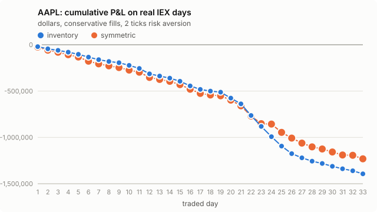

# AAPL: Avellaneda-Stoikov on real IEX data, day by day

- Traded days: 38 (2026-10-02 to 2026-11-25)
- Calibration-only days: 2; days without IEX data: 0

- IEX only: Alpaca's free plan carries the IEX exchange's own quotes and trades, a few percent of US volume. The strategy is simulated as if it quoted on IEX alone.
- No queue position: IEX data has the best bid and ask, not the order-by-order book. The conservative rule fills a quote only on a trade through its price; the optimistic rule also on a trade at it. The truth lies between the two.
- Calibrated on earlier days only (up to five). The first day of each stock only calibrates.
- P&L is in dollars, one lot of 100 shares per side, 30-minute windows that each start and end flat at the mid, before fees and rebates.

## Headline

Inventory strategy, risk aversion 2 ticks per lot.

- **conservative**: mean daily P&L -44050.85 [-54771.27, -34596.73] dollars (negative); 0 of 38 days positive; 5487 fills a day; 5 s markout -23.703 [-26.194, -21.367] ticks per fill (negative is against us).
- **optimistic**: mean daily P&L -44584.75 [-55378.45, -35078.07] dollars (negative); 0 of 38 days positive; 6205 fills a day; 5 s markout -21.726 [-24.199, -19.446] ticks per fill (negative is against us).

## Every setting

Mean over days, 95% bootstrap interval over days in brackets.

| rule | strategy | risk aversion (ticks) | daily P&L ($) | verdict | positive days | fills/day | 5 s markout (ticks) |
|---|---|---|---|---|---|---|---|
| conservative | inventory | 1 | -45021.63 [-55927.72, -35447.40] | negative | 0/38 | 5468 | -23.759 [-26.291, -21.394] |
| conservative | symmetric | 1 | -40499.85 [-49843.65, -32363.81] | negative | 0/38 | 5147 | -24.150 [-26.679, -21.755] |
| conservative | inventory | 2 | -44050.85 [-54771.27, -34596.73] | negative | 0/38 | 5487 | -23.703 [-26.194, -21.367] |
| conservative | symmetric | 2 | -40160.68 [-49455.07, -32074.05] | negative | 0/38 | 5013 | -24.611 [-27.179, -22.189] |
| conservative | inventory | 4 | -42331.55 [-52681.58, -33307.52] | negative | 0/38 | 5390 | -23.885 [-26.371, -21.549] |
| conservative | symmetric | 4 | -39201.89 [-48164.19, -31369.48] | negative | 0/38 | 4767 | -25.454 [-28.052, -23.039] |
| optimistic | inventory | 1 | -45462.67 [-56458.91, -35889.45] | negative | 0/38 | 6220 | -21.718 [-24.249, -19.435] |
| optimistic | symmetric | 1 | -41166.83 [-50670.38, -32781.45] | negative | 1/38 | 5889 | -21.949 [-24.442, -19.650] |
| optimistic | inventory | 2 | -44584.75 [-55378.45, -35078.07] | negative | 0/38 | 6205 | -21.726 [-24.199, -19.446] |
| optimistic | symmetric | 2 | -40792.75 [-50277.24, -32491.01] | negative | 1/38 | 5708 | -22.445 [-24.950, -20.147] |
| optimistic | inventory | 4 | -42906.19 [-53252.61, -33836.11] | negative | 0/38 | 6050 | -21.995 [-24.437, -19.741] |
| optimistic | symmetric | 4 | -39844.39 [-49126.79, -31709.28] | negative | 0/38 | 5385 | -23.331 [-25.830, -20.986] |

## Does inventory control help?

Daily P&L of the inventory strategy minus the symmetric one, paired by day.

| rule | risk aversion (ticks) | inventory minus symmetric ($/day) | verdict |
|---|---|---|---|
| conservative | 1 | -4521.78 [-12379.76, 1183.50] | not established |
| conservative | 2 | -3890.17 [-11428.36, 1586.55] | not established |
| conservative | 4 | -3129.66 [-10180.54, 2088.27] | not established |
| optimistic | 1 | -4295.84 [-12695.10, 1770.68] | not established |
| optimistic | 2 | -3791.99 [-11872.25, 2105.97] | not established |
| optimistic | 4 | -3061.80 [-10477.58, 2450.76] | not established |

## Day by day

Inventory strategy at 2 ticks.

| date | sigma ($/sqrt s) | A / k (conservative) | P&L conservative ($) | P&L optimistic ($) | fills (cons.) | 5 s markout (ticks, cons.) | IEX data |
|---|---|---|---|---|---|---|---|
| 2026-10-01 | calibration only |  |  |  |  |  | no earlier day to calibrate on; this day only calibrates |
| 2026-10-02 | 0.03590 | 0.1627 / 21.8 | -20422.65 | -20056.01 | 2805 | -21.307 | 100% quoted, 18831 trades |
| 2026-10-05 | 0.03352 | 0.1556 / 24.5 | -23657.69 | -23811.35 | 4159 | -17.189 | 100% quoted, 21277 trades |
| 2026-10-06 | 0.03492 | 0.1547 / 23.4 | -16586.88 | -16698.85 | 3883 | -16.620 | 100% quoted, 17706 trades |
| 2026-10-07 | 0.03494 | 0.1521 / 22.9 | -19191.59 | -19890.24 | 4187 | -16.319 | 100% quoted, 22360 trades |
| 2026-10-08 | 0.03494 | 0.1561 / 22.6 | -22937.02 | -23554.55 | 4768 | -18.093 | 100% quoted, 21964 trades |
| 2026-10-09 | 0.03552 | 0.1602 / 22.4 | -30969.88 | -31701.81 | 5736 | -17.518 | 100% quoted, 30585 trades |
| 2026-10-12 | 0.03760 | 0.1646 / 20.4 | -27309.15 | -27596.35 | 3327 | -26.526 | 100% quoted, 16325 trades |
| 2026-10-13 | calibration only |  |  |  |  |  | no earlier day to calibrate on; this day only calibrates |
| 2026-10-14 | 0.04355 | 0.1628 / 18.8 | -19274.68 | -20392.63 | 5006 | -14.498 | 100% quoted, 32766 trades |
| 2026-10-15 | 0.04310 | 0.1754 / 19.3 | -13261.23 | -13383.33 | 2902 | -18.648 | 100% quoted, 21362 trades |
| 2026-10-16 | 0.04253 | 0.1672 / 19.7 | -29159.03 | -29472.61 | 6166 | -15.879 | 100% quoted, 29380 trades |
| 2026-10-19 | 0.04269 | 0.1770 / 19.8 | -32431.15 | -33558.76 | 4833 | -23.095 | 100% quoted, 21058 trades |
| 2026-10-20 | 0.04106 | 0.1818 / 19.7 | -58622.64 | -57997.89 | 4256 | -33.597 | 100% quoted, 19216 trades |
| 2026-10-21 | 0.05390 | 0.1790 / 20.8 | -23484.60 | -23720.65 | 4470 | -16.976 | 100% quoted, 19414 trades |
| 2026-10-22 | 0.05449 | 0.1601 / 19.4 | -22919.69 | -23863.97 | 5135 | -11.504 | 100% quoted, 21118 trades |
| 2026-10-23 | 0.05418 | 0.1687 / 17.7 | -34143.81 | -34924.81 | 4547 | -24.544 | 100% quoted, 19025 trades |
| 2026-10-26 | 0.06266 | 0.1529 / 17.0 | -49956.47 | -51251.85 | 5340 | -30.478 | 100% quoted, 22165 trades |
| 2026-10-27 | 0.06605 | 0.1548 / 16.5 | -37592.69 | -38932.58 | 3871 | -31.369 | 100% quoted, 23909 trades |
| 2026-10-28 | 0.05709 | 0.1607 / 17.1 | -18242.35 | -18991.81 | 2915 | -22.848 | 100% quoted, 19597 trades |
| 2026-10-29 | 0.05757 | 0.1600 / 18.0 | -11580.52 | -11787.24 | 2538 | -16.161 | 100% quoted, 22448 trades |
| 2026-10-30 | 0.05669 | 0.1551 / 20.6 | -64029.90 | -65720.71 | 9404 | -20.676 | 100% quoted, 40818 trades |
| 2026-11-02 | 0.05117 | 0.1819 / 20.2 | -62266.35 | -63460.68 | 9692 | -22.000 | 100% quoted, 39739 trades |
| 2026-11-03 | 0.04913 | 0.2006 / 19.3 | -125111.33 | -125529.76 | 12054 | -20.532 | 100% quoted, 37510 trades |
| 2026-11-04 | 0.05612 | 0.2090 / 15.4 | -118452.16 | -120375.69 | 11492 | -30.935 | 100% quoted, 46835 trades |
| 2026-11-05 | 0.06740 | 0.2421 / 14.1 | -110660.16 | -112827.90 | 14483 | -25.187 | 100% quoted, 64164 trades |
| 2026-11-06 | 0.07151 | 0.2904 / 12.5 | -101595.87 | -101959.44 | 7821 | -36.925 | 100% quoted, 27562 trades |
| 2026-11-09 | 0.07380 | 0.2740 / 11.4 | -81119.60 | -82012.08 | 5400 | -44.521 | 100% quoted, 25966 trades |
| 2026-11-10 | 0.08039 | 0.2600 / 11.1 | -45489.20 | -45651.85 | 2960 | -40.985 | 100% quoted, 25690 trades |
| 2026-11-11 | 0.07687 | 0.2518 / 13.3 | -36133.44 | -36476.83 | 4802 | -24.631 | 100% quoted, 21401 trades |
| 2026-11-12 | 0.06857 | 0.2230 / 13.5 | -25056.93 | -25747.52 | 2996 | -27.622 | 100% quoted, 26600 trades |
| 2026-11-13 | 0.06529 | 0.1821 / 15.8 | -30096.45 | -31228.66 | 4534 | -23.331 | 100% quoted, 24593 trades |
| 2026-11-16 | 0.05844 | 0.1779 / 18.2 | -26663.18 | -26999.65 | 3167 | -26.494 | 100% quoted, 22498 trades |
| 2026-11-17 | 0.04795 | 0.1743 / 20.8 | -21518.39 | -22235.46 | 4418 | -17.933 | 100% quoted, 25918 trades |
| 2026-11-18 | 0.04225 | 0.1783 / 21.8 | -33275.53 | -34376.75 | 4066 | -24.017 | 100% quoted, 18278 trades |
| 2026-11-19 | 0.04231 | 0.1769 / 23.0 | -38271.83 | -37557.32 | 4963 | -21.241 | 100% quoted, 32498 trades |
| 2026-11-20 | 0.04533 | 0.1928 / 23.3 | -41393.55 | -40863.84 | 7258 | -18.203 | 100% quoted, 39850 trades |
| 2026-11-23 | 0.05030 | 0.2129 / 22.8 | -21931.94 | -21760.85 | 4784 | -16.504 | 100% quoted, 28121 trades |
| 2026-11-24 | 0.04895 | 0.2209 / 22.3 | -84137.38 | -83106.03 | 6456 | -35.154 | 100% quoted, 23920 trades |
| 2026-11-25 | 0.06010 | 0.2193 / 20.6 | -94985.38 | -94742.01 | 6924 | -30.650 | 100% quoted, 36052 trades |
