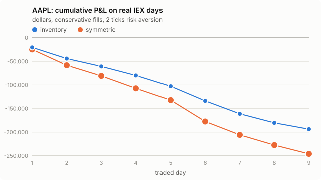

# AAPL: Avellaneda-Stoikov on real IEX data, day by day

- Traded days: 19 (2026-10-02 to 2026-10-29)
- Calibration-only days: 2; days without IEX data: 0

- IEX only: Alpaca's free plan carries the IEX exchange's own quotes and trades, a few percent of US volume. The strategy is simulated as if it quoted on IEX alone.
- No queue position: IEX data has the best bid and ask, not the order-by-order book. The conservative rule fills a quote only on a trade through its price; the optimistic rule also on a trade at it. The truth lies between the two.
- Calibrated on earlier days only (up to five). The first day of each stock only calibrates.
- P&L is in dollars, one lot of 100 shares per side, 30-minute windows that each start and end flat at the mid, before fees and rebates.

## Headline

Inventory strategy, risk aversion 2 ticks per lot.

- **conservative**: mean daily P&L -26933.88 [-32644.27, -22164.93] dollars (negative); 0 of 19 days positive; 4255 fills a day; 5 s markout -20.693 [-23.518, -18.137] ticks per fill (negative is against us).
- **optimistic**: mean daily P&L -27451.96 [-33095.67, -22577.34] dollars (negative); 0 of 19 days positive; 4938 fills a day; 5 s markout -18.717 [-21.289, -16.351] ticks per fill (negative is against us).

## Every setting

Mean over days, 95% bootstrap interval over days in brackets.

| rule | strategy | risk aversion (ticks) | daily P&L ($) | verdict | positive days | fills/day | 5 s markout (ticks) |
|---|---|---|---|---|---|---|---|
| conservative | inventory | 1 | -27772.38 [-33543.88, -22930.55] | negative | 0/19 | 4239 | -20.723 [-23.519, -18.199] |
| conservative | symmetric | 1 | -29376.18 [-34995.40, -24137.18] | negative | 0/19 | 3997 | -21.328 [-24.367, -18.660] |
| conservative | inventory | 2 | -26933.88 [-32644.27, -22164.93] | negative | 0/19 | 4255 | -20.693 [-23.518, -18.137] |
| conservative | symmetric | 2 | -28994.39 [-34631.76, -23797.13] | negative | 0/19 | 3889 | -21.723 [-24.784, -19.045] |
| conservative | inventory | 4 | -25829.10 [-31202.57, -21205.86] | negative | 0/19 | 4180 | -20.843 [-23.757, -18.253] |
| conservative | symmetric | 4 | -28189.94 [-33565.67, -23118.30] | negative | 0/19 | 3683 | -22.509 [-25.596, -19.759] |
| optimistic | inventory | 1 | -28212.99 [-34060.29, -23287.25] | negative | 0/19 | 4945 | -18.698 [-21.271, -16.362] |
| optimistic | symmetric | 1 | -30475.97 [-36164.30, -25125.01] | negative | 0/19 | 4664 | -19.185 [-21.863, -16.778] |
| optimistic | inventory | 2 | -27451.96 [-33095.67, -22577.34] | negative | 0/19 | 4938 | -18.717 [-21.289, -16.351] |
| optimistic | symmetric | 2 | -30089.62 [-35811.60, -24781.67] | negative | 0/19 | 4499 | -19.699 [-22.457, -17.230] |
| optimistic | inventory | 4 | -26387.38 [-31725.84, -21715.57] | negative | 0/19 | 4799 | -18.981 [-21.605, -16.602] |
| optimistic | symmetric | 4 | -29046.36 [-34668.91, -23815.91] | negative | 0/19 | 4223 | -20.504 [-23.347, -17.941] |

## Does inventory control help?

Daily P&L of the inventory strategy minus the symmetric one, paired by day.

| rule | risk aversion (ticks) | inventory minus symmetric ($/day) | verdict |
|---|---|---|---|
| conservative | 1 | 1603.80 [-1151.61, 4121.48] | not established |
| conservative | 2 | 2060.51 [-489.76, 4461.33] | not established |
| conservative | 4 | 2360.84 [110.60, 4480.16] | positive |
| optimistic | 1 | 2262.98 [-655.54, 4877.58] | not established |
| optimistic | 2 | 2637.66 [-130.07, 5205.50] | not established |
| optimistic | 4 | 2658.98 [238.84, 4952.87] | positive |

## Day by day

Inventory strategy at 2 ticks.

| date | sigma ($/sqrt s) | A / k (conservative) | P&L conservative ($) | P&L optimistic ($) | fills (cons.) | 5 s markout (ticks, cons.) | IEX data |
|---|---|---|---|---|---|---|---|
| 2026-10-01 | calibration only |  |  |  |  |  | no earlier day to calibrate on; this day only calibrates |
| 2026-10-02 | 0.03590 | 0.1627 / 21.8 | -20422.65 | -20056.01 | 2805 | -21.307 | 100% quoted, 18831 trades |
| 2026-10-05 | 0.03352 | 0.1556 / 24.5 | -23657.69 | -23811.35 | 4159 | -17.189 | 100% quoted, 21277 trades |
| 2026-10-06 | 0.03492 | 0.1547 / 23.4 | -16586.88 | -16698.85 | 3883 | -16.620 | 100% quoted, 17706 trades |
| 2026-10-07 | 0.03494 | 0.1521 / 22.9 | -19191.59 | -19890.24 | 4187 | -16.319 | 100% quoted, 22360 trades |
| 2026-10-08 | 0.03494 | 0.1561 / 22.6 | -22937.02 | -23554.55 | 4768 | -18.093 | 100% quoted, 21964 trades |
| 2026-10-09 | 0.03552 | 0.1602 / 22.4 | -30969.88 | -31701.81 | 5736 | -17.518 | 100% quoted, 30585 trades |
| 2026-10-12 | 0.03760 | 0.1646 / 20.4 | -27309.15 | -27596.35 | 3327 | -26.526 | 100% quoted, 16325 trades |
| 2026-10-13 | calibration only |  |  |  |  |  | no earlier day to calibrate on; this day only calibrates |
| 2026-10-14 | 0.04355 | 0.1628 / 18.8 | -19274.68 | -20392.63 | 5006 | -14.498 | 100% quoted, 32766 trades |
| 2026-10-15 | 0.04310 | 0.1754 / 19.3 | -13261.23 | -13383.33 | 2902 | -18.648 | 100% quoted, 21362 trades |
| 2026-10-16 | 0.04253 | 0.1672 / 19.7 | -29159.03 | -29472.61 | 6166 | -15.879 | 100% quoted, 29380 trades |
| 2026-10-19 | 0.04269 | 0.1770 / 19.8 | -32431.15 | -33558.76 | 4833 | -23.095 | 100% quoted, 21058 trades |
| 2026-10-20 | 0.04106 | 0.1818 / 19.7 | -58622.64 | -57997.89 | 4256 | -33.597 | 100% quoted, 19216 trades |
| 2026-10-21 | 0.05390 | 0.1790 / 20.8 | -23484.60 | -23720.65 | 4470 | -16.976 | 100% quoted, 19414 trades |
| 2026-10-22 | 0.05449 | 0.1601 / 19.4 | -22919.69 | -23863.97 | 5135 | -11.504 | 100% quoted, 21118 trades |
| 2026-10-23 | 0.05418 | 0.1687 / 17.7 | -34143.81 | -34924.81 | 4547 | -24.544 | 100% quoted, 19025 trades |
| 2026-10-26 | 0.06266 | 0.1529 / 17.0 | -49956.47 | -51251.85 | 5340 | -30.478 | 100% quoted, 22165 trades |
| 2026-10-27 | 0.06605 | 0.1548 / 16.5 | -37592.69 | -38932.58 | 3871 | -31.369 | 100% quoted, 23909 trades |
| 2026-10-28 | 0.05709 | 0.1607 / 17.1 | -18242.35 | -18991.81 | 2915 | -22.848 | 100% quoted, 19597 trades |
| 2026-10-29 | 0.05757 | 0.1600 / 18.0 | -11580.52 | -11787.24 | 2538 | -16.161 | 100% quoted, 22448 trades |
