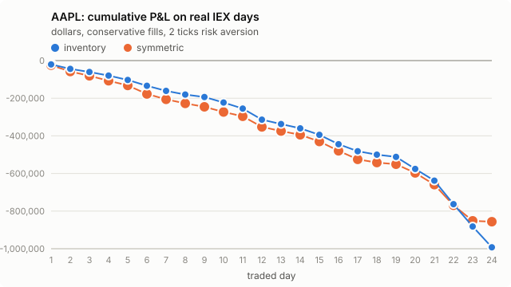

# AAPL: Avellaneda-Stoikov on real IEX data, day by day

- Traded days: 24 (2026-10-02 to 2026-11-05)
- Calibration-only days: 2; days without IEX data: 0

- IEX only: Alpaca's free plan carries the IEX exchange's own quotes and trades, a few percent of US volume. The strategy is simulated as if it quoted on IEX alone.
- No queue position: IEX data has the best bid and ask, not the order-by-order book. The conservative rule fills a quote only on a trade through its price; the optimistic rule also on a trade at it. The truth lies between the two.
- Calibrated on earlier days only (up to five). The first day of each stock only calibrates.
- P&L is in dollars, one lot of 100 shares per side, 30-minute windows that each start and end flat at the mid, before fees and rebates.

## Headline

Inventory strategy, risk aversion 2 ticks per lot.

- **conservative**: mean daily P&L -41344.32 [-54943.30, -29875.15] dollars (negative); 0 of 24 days positive; 5749 fills a day; 5 s markout -21.354 [-23.659, -19.140] ticks per fill (negative is against us).
- **optimistic**: mean daily P&L -42062.59 [-55836.05, -30442.75] dollars (negative); 0 of 24 days positive; 6494 fills a day; 5 s markout -19.475 [-21.643, -17.407] ticks per fill (negative is against us).

## Every setting

Mean over days, 95% bootstrap interval over days in brackets.

| rule | strategy | risk aversion (ticks) | daily P&L ($) | verdict | positive days | fills/day | 5 s markout (ticks) |
|---|---|---|---|---|---|---|---|
| conservative | inventory | 1 | -42482.43 [-56336.60, -30727.44] | negative | 0/24 | 5728 | -21.387 [-23.747, -19.160] |
| conservative | symmetric | 1 | -36014.61 [-45801.10, -27483.79] | negative | 0/24 | 5385 | -21.826 [-24.324, -19.516] |
| conservative | inventory | 2 | -41344.32 [-54943.30, -29875.15] | negative | 0/24 | 5749 | -21.354 [-23.659, -19.140] |
| conservative | symmetric | 2 | -35680.67 [-45520.12, -27089.69] | negative | 0/24 | 5258 | -22.212 [-24.724, -19.875] |
| conservative | inventory | 4 | -39437.79 [-52173.75, -28484.54] | negative | 0/24 | 5641 | -21.506 [-23.796, -19.299] |
| conservative | symmetric | 4 | -34538.49 [-43905.04, -26418.55] | negative | 0/24 | 5020 | -22.956 [-25.445, -20.583] |
| optimistic | inventory | 1 | -43088.10 [-57086.22, -31211.23] | negative | 0/24 | 6500 | -19.474 [-21.677, -17.360] |
| optimistic | symmetric | 1 | -36936.15 [-46976.27, -28105.46] | negative | 1/24 | 6139 | -19.788 [-22.077, -17.654] |
| optimistic | inventory | 2 | -42062.59 [-55836.05, -30442.75] | negative | 0/24 | 6494 | -19.475 [-21.643, -17.407] |
| optimistic | symmetric | 2 | -36439.28 [-46366.93, -27696.82] | negative | 1/24 | 5959 | -20.263 [-22.589, -18.074] |
| optimistic | inventory | 4 | -40166.99 [-53125.01, -29162.03] | negative | 0/24 | 6321 | -19.761 [-21.929, -17.666] |
| optimistic | symmetric | 4 | -35431.55 [-45137.60, -26947.85] | negative | 0/24 | 5645 | -21.042 [-23.425, -18.809] |

## Does inventory control help?

Daily P&L of the inventory strategy minus the symmetric one, paired by day.

| rule | risk aversion (ticks) | inventory minus symmetric ($/day) | verdict |
|---|---|---|---|
| conservative | 1 | -6467.82 [-18534.06, 1040.30] | not established |
| conservative | 2 | -5663.65 [-16844.95, 1511.76] | not established |
| conservative | 4 | -4899.30 [-15234.55, 1823.13] | not established |
| optimistic | 1 | -6151.95 [-18764.99, 1802.97] | not established |
| optimistic | 2 | -5623.30 [-17802.28, 2168.80] | not established |
| optimistic | 4 | -4735.44 [-15558.69, 2265.56] | not established |

## Day by day

Inventory strategy at 2 ticks.

| date | sigma ($/sqrt s) | A / k (conservative) | P&L conservative ($) | P&L optimistic ($) | fills (cons.) | 5 s markout (ticks, cons.) | IEX data |
|---|---|---|---|---|---|---|---|
| 2026-10-01 | calibration only |  |  |  |  |  | no earlier day to calibrate on; this day only calibrates |
| 2026-10-02 | 0.03590 | 0.1627 / 21.8 | -20422.65 | -20056.01 | 2805 | -21.307 | 100% quoted, 18831 trades |
| 2026-10-05 | 0.03352 | 0.1556 / 24.5 | -23657.69 | -23811.35 | 4159 | -17.189 | 100% quoted, 21277 trades |
| 2026-10-06 | 0.03492 | 0.1547 / 23.4 | -16586.88 | -16698.85 | 3883 | -16.620 | 100% quoted, 17706 trades |
| 2026-10-07 | 0.03494 | 0.1521 / 22.9 | -19191.59 | -19890.24 | 4187 | -16.319 | 100% quoted, 22360 trades |
| 2026-10-08 | 0.03494 | 0.1561 / 22.6 | -22937.02 | -23554.55 | 4768 | -18.093 | 100% quoted, 21964 trades |
| 2026-10-09 | 0.03552 | 0.1602 / 22.4 | -30969.88 | -31701.81 | 5736 | -17.518 | 100% quoted, 30585 trades |
| 2026-10-12 | 0.03760 | 0.1646 / 20.4 | -27309.15 | -27596.35 | 3327 | -26.526 | 100% quoted, 16325 trades |
| 2026-10-13 | calibration only |  |  |  |  |  | no earlier day to calibrate on; this day only calibrates |
| 2026-10-14 | 0.04355 | 0.1628 / 18.8 | -19274.68 | -20392.63 | 5006 | -14.498 | 100% quoted, 32766 trades |
| 2026-10-15 | 0.04310 | 0.1754 / 19.3 | -13261.23 | -13383.33 | 2902 | -18.648 | 100% quoted, 21362 trades |
| 2026-10-16 | 0.04253 | 0.1672 / 19.7 | -29159.03 | -29472.61 | 6166 | -15.879 | 100% quoted, 29380 trades |
| 2026-10-19 | 0.04269 | 0.1770 / 19.8 | -32431.15 | -33558.76 | 4833 | -23.095 | 100% quoted, 21058 trades |
| 2026-10-20 | 0.04106 | 0.1818 / 19.7 | -58622.64 | -57997.89 | 4256 | -33.597 | 100% quoted, 19216 trades |
| 2026-10-21 | 0.05390 | 0.1790 / 20.8 | -23484.60 | -23720.65 | 4470 | -16.976 | 100% quoted, 19414 trades |
| 2026-10-22 | 0.05449 | 0.1601 / 19.4 | -22919.69 | -23863.97 | 5135 | -11.504 | 100% quoted, 21118 trades |
| 2026-10-23 | 0.05418 | 0.1687 / 17.7 | -34143.81 | -34924.81 | 4547 | -24.544 | 100% quoted, 19025 trades |
| 2026-10-26 | 0.06266 | 0.1529 / 17.0 | -49956.47 | -51251.85 | 5340 | -30.478 | 100% quoted, 22165 trades |
| 2026-10-27 | 0.06605 | 0.1548 / 16.5 | -37592.69 | -38932.58 | 3871 | -31.369 | 100% quoted, 23909 trades |
| 2026-10-28 | 0.05709 | 0.1607 / 17.1 | -18242.35 | -18991.81 | 2915 | -22.848 | 100% quoted, 19597 trades |
| 2026-10-29 | 0.05757 | 0.1600 / 18.0 | -11580.52 | -11787.24 | 2538 | -16.161 | 100% quoted, 22448 trades |
| 2026-10-30 | 0.05669 | 0.1551 / 20.6 | -64029.90 | -65720.71 | 9404 | -20.676 | 100% quoted, 40818 trades |
| 2026-11-02 | 0.05117 | 0.1819 / 20.2 | -62266.35 | -63460.68 | 9692 | -22.000 | 100% quoted, 39739 trades |
| 2026-11-03 | 0.04913 | 0.2006 / 19.3 | -125111.33 | -125529.76 | 12054 | -20.532 | 100% quoted, 37510 trades |
| 2026-11-04 | 0.05612 | 0.2090 / 15.4 | -118452.16 | -120375.69 | 11492 | -30.935 | 100% quoted, 46835 trades |
| 2026-11-05 | 0.06740 | 0.2421 / 14.1 | -110660.16 | -112827.90 | 14483 | -25.187 | 100% quoted, 64164 trades |
