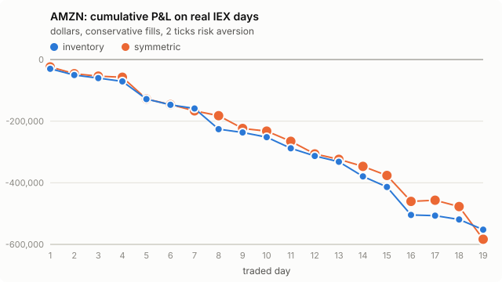

# AMZN: Avellaneda-Stoikov on real IEX data, day by day

- Traded days: 12 (2026-10-02 to 2026-10-20)
- Calibration-only days: 2; days without IEX data: 0

- IEX only: Alpaca's free plan carries the IEX exchange's own quotes and trades, a few percent of US volume. The strategy is simulated as if it quoted on IEX alone.
- No queue position: IEX data has the best bid and ask, not the order-by-order book. The conservative rule fills a quote only on a trade through its price; the optimistic rule also on a trade at it. The truth lies between the two.
- Calibrated on earlier days only (up to five). The first day of each stock only calibrates.
- P&L is in dollars, one lot of 100 shares per side, 30-minute windows that each start and end flat at the mid, before fees and rebates.

## Headline

Inventory strategy, risk aversion 2 ticks per lot.

- **conservative**: mean daily P&L -26075.81 [-37550.61, -16367.79] dollars (negative); 0 of 12 days positive; 2638 fills a day; 5 s markout -20.920 [-30.357, -14.222] ticks per fill (negative is against us).
- **optimistic**: mean daily P&L -26524.00 [-38333.97, -16554.01] dollars (negative); 0 of 12 days positive; 3041 fills a day; 5 s markout -18.921 [-27.311, -12.845] ticks per fill (negative is against us).

## Every setting

Mean over days, 95% bootstrap interval over days in brackets.

| rule | strategy | risk aversion (ticks) | daily P&L ($) | verdict | positive days | fills/day | 5 s markout (ticks) |
|---|---|---|---|---|---|---|---|
| conservative | inventory | 1 | -26512.24 [-37652.64, -17061.25] | negative | 0/12 | 2669 | -20.698 [-29.897, -14.148] |
| conservative | symmetric | 1 | -25671.69 [-36954.75, -16174.70] | negative | 0/12 | 2492 | -17.996 [-23.946, -13.646] |
| conservative | inventory | 2 | -26075.81 [-37550.61, -16367.79] | negative | 0/12 | 2638 | -20.920 [-30.357, -14.222] |
| conservative | symmetric | 2 | -25528.95 [-36890.05, -16255.12] | negative | 0/12 | 2402 | -18.480 [-24.604, -14.007] |
| conservative | inventory | 4 | -25289.65 [-37375.03, -15201.17] | negative | 0/12 | 2521 | -21.205 [-30.440, -14.578] |
| conservative | symmetric | 4 | -24933.16 [-35937.13, -15842.88] | negative | 0/12 | 2251 | -19.308 [-25.933, -14.598] |
| optimistic | inventory | 1 | -26779.79 [-38107.17, -17144.83] | negative | 0/12 | 3095 | -18.623 [-26.726, -12.696] |
| optimistic | symmetric | 1 | -25935.97 [-37447.61, -16039.21] | negative | 0/12 | 2937 | -15.802 [-20.629, -12.111] |
| optimistic | inventory | 2 | -26524.00 [-38333.97, -16554.01] | negative | 0/12 | 3041 | -18.921 [-27.311, -12.845] |
| optimistic | symmetric | 2 | -25485.27 [-36974.57, -15776.42] | negative | 0/12 | 2814 | -16.332 [-21.302, -12.522] |
| optimistic | inventory | 4 | -25677.56 [-38014.54, -15385.08] | negative | 0/12 | 2880 | -19.433 [-28.096, -13.184] |
| optimistic | symmetric | 4 | -24960.24 [-36182.70, -15610.59] | negative | 0/12 | 2608 | -17.324 [-23.099, -13.114] |

## Does inventory control help?

Daily P&L of the inventory strategy minus the symmetric one, paired by day.

| rule | risk aversion (ticks) | inventory minus symmetric ($/day) | verdict |
|---|---|---|---|
| conservative | 1 | -840.55 [-11679.13, 8380.84] | not established |
| conservative | 2 | -546.86 [-11900.49, 9150.69] | not established |
| conservative | 4 | -356.49 [-12610.65, 9752.20] | not established |
| optimistic | 1 | -843.82 [-11619.86, 8799.61] | not established |
| optimistic | 2 | -1038.73 [-12935.01, 9358.70] | not established |
| optimistic | 4 | -717.32 [-13901.91, 10359.43] | not established |

## Day by day

Inventory strategy at 2 ticks.

| date | sigma ($/sqrt s) | A / k (conservative) | P&L conservative ($) | P&L optimistic ($) | fills (cons.) | 5 s markout (ticks, cons.) | IEX data |
|---|---|---|---|---|---|---|---|
| 2026-10-01 | calibration only |  |  |  |  |  | no earlier day to calibrate on; this day only calibrates |
| 2026-10-02 | 0.05668 | 0.1233 / 27.9 | -30045.81 | -30079.37 | 2367 | -29.095 | 100% quoted, 13756 trades |
| 2026-10-05 | 0.04825 | 0.1181 / 27.1 | -20339.61 | -20764.35 | 3271 | -13.002 | 100% quoted, 15058 trades |
| 2026-10-06 | 0.04333 | 0.1204 / 23.8 | -9806.57 | -9785.46 | 1742 | -12.999 | 100% quoted, 15857 trades |
| 2026-10-07 | 0.04001 | 0.1208 / 25.4 | -10714.98 | -10932.95 | 2557 | -11.542 | 100% quoted, 13432 trades |
| 2026-10-08 | 0.03757 | 0.1203 / 24.6 | -57570.03 | -58213.54 | 3770 | -25.776 | 100% quoted, 18135 trades |
| 2026-10-09 | 0.04527 | 0.1247 / 23.0 | -18458.69 | -18608.94 | 2452 | -14.765 | 100% quoted, 12249 trades |
| 2026-10-12 | 0.04566 | 0.1223 / 21.8 | -11862.88 | -12733.79 | 1762 | -15.701 | 100% quoted, 11529 trades |
| 2026-10-13 | calibration only |  |  |  |  |  | no earlier day to calibrate on; this day only calibrates |
| 2026-10-14 | 0.04917 | 0.1128 / 21.9 | -67220.40 | -69167.13 | 2365 | -66.562 | 100% quoted, 14568 trades |
| 2026-10-15 | 0.06091 | 0.1144 / 22.8 | -10732.59 | -10506.59 | 1935 | -10.823 | 100% quoted, 15912 trades |
| 2026-10-16 | 0.05059 | 0.1108 / 24.4 | -15149.75 | -15361.85 | 2753 | -11.274 | 100% quoted, 19489 trades |
| 2026-10-19 | 0.04950 | 0.1238 / 25.8 | -36090.78 | -36935.65 | 3890 | -22.708 | 100% quoted, 20463 trades |
| 2026-10-20 | 0.05308 | 0.1344 / 24.0 | -24917.59 | -25198.38 | 2796 | -16.793 | 100% quoted, 20750 trades |
