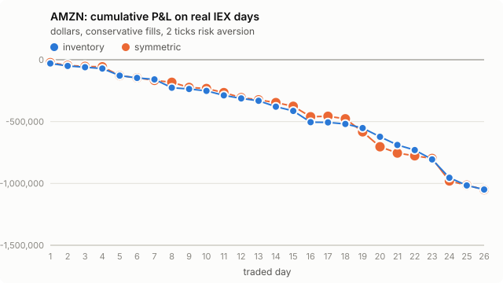

# AMZN: Avellaneda-Stoikov on real IEX data, day by day

- Traded days: 21 (2026-10-02 to 2026-11-02)
- Calibration-only days: 2; days without IEX data: 0

- IEX only: Alpaca's free plan carries the IEX exchange's own quotes and trades, a few percent of US volume. The strategy is simulated as if it quoted on IEX alone.
- No queue position: IEX data has the best bid and ask, not the order-by-order book. The conservative rule fills a quote only on a trade through its price; the optimistic rule also on a trade at it. The truth lies between the two.
- Calibrated on earlier days only (up to five). The first day of each stock only calibrates.
- P&L is in dollars, one lot of 100 shares per side, 30-minute windows that each start and end flat at the mid, before fees and rebates.

## Headline

Inventory strategy, risk aversion 2 ticks per lot.

- **conservative**: mean daily P&L -32810.08 [-43580.99, -23210.76] dollars (negative); 0 of 21 days positive; 3258 fills a day; 5 s markout -20.054 [-25.998, -15.409] ticks per fill (negative is against us).
- **optimistic**: mean daily P&L -33193.06 [-44064.53, -23516.31] dollars (negative); 0 of 21 days positive; 3709 fills a day; 5 s markout -18.204 [-23.502, -13.997] ticks per fill (negative is against us).

## Every setting

Mean over days, 95% bootstrap interval over days in brackets.

| rule | strategy | risk aversion (ticks) | daily P&L ($) | verdict | positive days | fills/day | 5 s markout (ticks) |
|---|---|---|---|---|---|---|---|
| conservative | inventory | 1 | -33448.74 [-44429.50, -23661.62] | negative | 0/21 | 3329 | -19.776 [-25.651, -15.119] |
| conservative | symmetric | 1 | -36212.16 [-51229.56, -23090.93] | negative | 1/21 | 3145 | -17.887 [-22.326, -14.293] |
| conservative | inventory | 2 | -32810.08 [-43580.99, -23210.76] | negative | 0/21 | 3258 | -20.054 [-25.998, -15.409] |
| conservative | symmetric | 2 | -35930.67 [-50763.17, -22973.27] | negative | 1/21 | 3044 | -18.273 [-22.820, -14.586] |
| conservative | inventory | 4 | -30988.16 [-41108.96, -21775.44] | negative | 0/21 | 3079 | -20.475 [-26.395, -15.853] |
| conservative | symmetric | 4 | -35181.09 [-49846.93, -22377.97] | negative | 1/21 | 2868 | -19.037 [-23.882, -15.157] |
| optimistic | inventory | 1 | -33765.55 [-44821.84, -23855.32] | negative | 0/21 | 3802 | -17.907 [-23.121, -13.772] |
| optimistic | symmetric | 1 | -35870.42 [-51198.55, -22412.85] | negative | 1/21 | 3644 | -15.897 [-19.658, -12.798] |
| optimistic | inventory | 2 | -33193.06 [-44064.53, -23516.31] | negative | 0/21 | 3709 | -18.204 [-23.502, -13.997] |
| optimistic | symmetric | 2 | -35550.87 [-50732.96, -22284.85] | negative | 1/21 | 3506 | -16.391 [-20.237, -13.194] |
| optimistic | inventory | 4 | -31407.27 [-41591.83, -22125.11] | negative | 0/21 | 3491 | -18.735 [-24.231, -14.420] |
| optimistic | symmetric | 4 | -35074.86 [-49973.27, -22061.60] | negative | 1/21 | 3274 | -17.320 [-21.634, -13.838] |

## Does inventory control help?

Daily P&L of the inventory strategy minus the symmetric one, paired by day.

| rule | risk aversion (ticks) | inventory minus symmetric ($/day) | verdict |
|---|---|---|---|
| conservative | 1 | 2763.41 [-6812.29, 13737.08] | not established |
| conservative | 2 | 3120.59 [-6726.06, 14308.33] | not established |
| conservative | 4 | 4192.92 [-6505.15, 15935.00] | not established |
| optimistic | 1 | 2104.87 [-7870.01, 13594.87] | not established |
| optimistic | 2 | 2357.81 [-8094.00, 14198.37] | not established |
| optimistic | 4 | 3667.59 [-7286.82, 15700.46] | not established |

## Day by day

Inventory strategy at 2 ticks.

| date | sigma ($/sqrt s) | A / k (conservative) | P&L conservative ($) | P&L optimistic ($) | fills (cons.) | 5 s markout (ticks, cons.) | IEX data |
|---|---|---|---|---|---|---|---|
| 2026-10-01 | calibration only |  |  |  |  |  | no earlier day to calibrate on; this day only calibrates |
| 2026-10-02 | 0.05668 | 0.1233 / 27.9 | -30045.81 | -30079.37 | 2367 | -29.095 | 100% quoted, 13756 trades |
| 2026-10-05 | 0.04825 | 0.1181 / 27.1 | -20339.61 | -20764.35 | 3271 | -13.002 | 100% quoted, 15058 trades |
| 2026-10-06 | 0.04333 | 0.1204 / 23.8 | -9806.57 | -9785.46 | 1742 | -12.999 | 100% quoted, 15857 trades |
| 2026-10-07 | 0.04001 | 0.1208 / 25.4 | -10714.98 | -10932.95 | 2557 | -11.542 | 100% quoted, 13432 trades |
| 2026-10-08 | 0.03757 | 0.1203 / 24.6 | -57570.03 | -58213.54 | 3770 | -25.776 | 100% quoted, 18135 trades |
| 2026-10-09 | 0.04527 | 0.1247 / 23.0 | -18458.69 | -18608.94 | 2452 | -14.765 | 100% quoted, 12249 trades |
| 2026-10-12 | 0.04566 | 0.1223 / 21.8 | -11862.88 | -12733.79 | 1762 | -15.701 | 100% quoted, 11529 trades |
| 2026-10-13 | calibration only |  |  |  |  |  | no earlier day to calibrate on; this day only calibrates |
| 2026-10-14 | 0.04917 | 0.1128 / 21.9 | -67220.40 | -69167.13 | 2365 | -66.562 | 100% quoted, 14568 trades |
| 2026-10-15 | 0.06091 | 0.1144 / 22.8 | -10732.59 | -10506.59 | 1935 | -10.823 | 100% quoted, 15912 trades |
| 2026-10-16 | 0.05059 | 0.1108 / 24.4 | -15149.75 | -15361.85 | 2753 | -11.274 | 100% quoted, 19489 trades |
| 2026-10-19 | 0.04950 | 0.1238 / 25.8 | -36090.78 | -36935.65 | 3890 | -22.708 | 100% quoted, 20463 trades |
| 2026-10-20 | 0.05308 | 0.1344 / 24.0 | -24917.59 | -25198.38 | 2796 | -16.793 | 100% quoted, 20750 trades |
| 2026-10-21 | 0.04994 | 0.1445 / 24.0 | -18910.46 | -19371.50 | 2459 | -15.609 | 100% quoted, 13131 trades |
| 2026-10-22 | 0.03676 | 0.1408 / 23.5 | -47417.76 | -47814.34 | 3312 | -20.338 | 100% quoted, 24341 trades |
| 2026-10-23 | 0.04230 | 0.1550 / 23.2 | -34309.42 | -34632.51 | 2085 | -27.441 | 100% quoted, 12733 trades |
| 2026-10-26 | 0.04882 | 0.1436 / 23.2 | -90904.54 | -91001.72 | 3620 | -36.779 | 100% quoted, 15344 trades |
| 2026-10-27 | 0.06421 | 0.1397 / 23.8 | -2355.69 | -2845.93 | 1586 | -7.489 | 100% quoted, 14019 trades |
| 2026-10-28 | 0.06301 | 0.1374 / 25.0 | -12322.61 | -12392.73 | 2319 | -12.269 | 100% quoted, 15892 trades |
| 2026-10-29 | 0.06212 | 0.1421 / 25.5 | -33199.81 | -33256.64 | 4815 | -11.706 | 100% quoted, 31345 trades |
| 2026-10-30 | 0.05934 | 0.1436 / 24.0 | -70783.23 | -71794.47 | 11239 | -12.058 | 100% quoted, 50453 trades |
| 2026-11-02 | 0.05710 | 0.1800 / 17.5 | -65898.51 | -65656.50 | 5321 | -26.406 | 100% quoted, 31068 trades |
