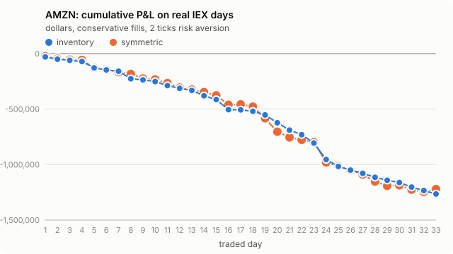

# AMZN: Avellaneda-Stoikov on real IEX data, day by day

- Traded days: 39 (2026-10-02 to 2026-11-27)
- Calibration-only days: 2; days without IEX data: 1

- IEX only: Alpaca's free plan carries the IEX exchange's own quotes and trades, a few percent of US volume. The strategy is simulated as if it quoted on IEX alone.
- No queue position: IEX data has the best bid and ask, not the order-by-order book. The conservative rule fills a quote only on a trade through its price; the optimistic rule also on a trade at it. The truth lies between the two.
- Calibrated on earlier days only (up to five). The first day of each stock only calibrates.
- P&L is in dollars, one lot of 100 shares per side, 30-minute windows that each start and end flat at the mid, before fees and rebates.

## Headline

Inventory strategy, risk aversion 2 ticks per lot.

- **conservative**: mean daily P&L -40958.27 [-50600.20, -32347.52] dollars (negative); 0 of 39 days positive; 4766 fills a day; 5 s markout -20.168 [-23.581, -17.452] ticks per fill (negative is against us).
- **optimistic**: mean daily P&L -41288.93 [-50983.50, -32661.79] dollars (negative); 0 of 39 days positive; 5282 fills a day; 5 s markout -18.698 [-21.758, -16.204] ticks per fill (negative is against us).

## Every setting

Mean over days, 95% bootstrap interval over days in brackets.

| rule | strategy | risk aversion (ticks) | daily P&L ($) | verdict | positive days | fills/day | 5 s markout (ticks) |
|---|---|---|---|---|---|---|---|
| conservative | inventory | 1 | -42000.06 [-52289.49, -32932.93] | negative | 0/39 | 4819 | -19.944 [-23.334, -17.239] |
| conservative | symmetric | 1 | -44566.01 [-60064.50, -31282.76] | negative | 3/39 | 4550 | -18.733 [-21.258, -16.495] |
| conservative | inventory | 2 | -40958.27 [-50600.20, -32347.52] | negative | 0/39 | 4766 | -20.168 [-23.581, -17.452] |
| conservative | symmetric | 2 | -44066.32 [-59308.39, -31069.02] | negative | 3/39 | 4433 | -19.057 [-21.668, -16.766] |
| conservative | inventory | 4 | -38259.31 [-47030.25, -30323.02] | negative | 0/39 | 4548 | -20.602 [-23.945, -17.891] |
| conservative | symmetric | 4 | -43220.14 [-58161.88, -30447.83] | negative | 3/39 | 4224 | -19.706 [-22.473, -17.311] |
| optimistic | inventory | 1 | -42290.81 [-52624.09, -33194.15] | negative | 0/39 | 5359 | -18.437 [-21.440, -15.974] |
| optimistic | symmetric | 1 | -44239.38 [-60134.53, -30520.80] | negative | 3/39 | 5091 | -17.159 [-19.423, -15.123] |
| optimistic | inventory | 2 | -41288.93 [-50983.50, -32661.79] | negative | 0/39 | 5282 | -18.698 [-21.758, -16.204] |
| optimistic | symmetric | 2 | -43792.03 [-59431.67, -30294.95] | negative | 3/39 | 4941 | -17.562 [-19.862, -15.482] |
| optimistic | inventory | 4 | -38630.87 [-47489.84, -30632.55] | negative | 0/39 | 5021 | -19.201 [-22.321, -16.617] |
| optimistic | symmetric | 4 | -42942.41 [-58243.01, -29764.66] | negative | 3/39 | 4677 | -18.310 [-20.820, -16.123] |

## Does inventory control help?

Daily P&L of the inventory strategy minus the symmetric one, paired by day.

| rule | risk aversion (ticks) | inventory minus symmetric ($/day) | verdict |
|---|---|---|---|
| conservative | 1 | 2565.95 [-6714.30, 12288.28] | not established |
| conservative | 2 | 3108.05 [-6392.08, 13133.87] | not established |
| conservative | 4 | 4960.83 [-4959.77, 15293.93] | not established |
| optimistic | 1 | 1948.58 [-7705.72, 11919.01] | not established |
| optimistic | 2 | 2503.10 [-7436.75, 13003.79] | not established |
| optimistic | 4 | 4311.54 [-6034.31, 15132.70] | not established |

## Day by day

Inventory strategy at 2 ticks.

| date | sigma ($/sqrt s) | A / k (conservative) | P&L conservative ($) | P&L optimistic ($) | fills (cons.) | 5 s markout (ticks, cons.) | IEX data |
|---|---|---|---|---|---|---|---|
| 2026-10-01 | calibration only |  |  |  |  |  | no earlier day to calibrate on; this day only calibrates |
| 2026-10-02 | 0.05668 | 0.1233 / 27.9 | -30045.81 | -30079.37 | 2367 | -29.095 | 100% quoted, 13756 trades |
| 2026-10-05 | 0.04825 | 0.1181 / 27.1 | -20339.61 | -20764.35 | 3271 | -13.002 | 100% quoted, 15058 trades |
| 2026-10-06 | 0.04333 | 0.1204 / 23.8 | -9806.57 | -9785.46 | 1742 | -12.999 | 100% quoted, 15857 trades |
| 2026-10-07 | 0.04001 | 0.1208 / 25.4 | -10714.98 | -10932.95 | 2557 | -11.542 | 100% quoted, 13432 trades |
| 2026-10-08 | 0.03757 | 0.1203 / 24.6 | -57570.03 | -58213.54 | 3770 | -25.776 | 100% quoted, 18135 trades |
| 2026-10-09 | 0.04527 | 0.1247 / 23.0 | -18458.69 | -18608.94 | 2452 | -14.765 | 100% quoted, 12249 trades |
| 2026-10-12 | 0.04566 | 0.1223 / 21.8 | -11862.88 | -12733.79 | 1762 | -15.701 | 100% quoted, 11529 trades |
| 2026-10-13 | calibration only |  |  |  |  |  | no earlier day to calibrate on; this day only calibrates |
| 2026-10-14 | 0.04917 | 0.1128 / 21.9 | -67220.40 | -69167.13 | 2365 | -66.562 | 100% quoted, 14568 trades |
| 2026-10-15 | 0.06091 | 0.1144 / 22.8 | -10732.59 | -10506.59 | 1935 | -10.823 | 100% quoted, 15912 trades |
| 2026-10-16 | 0.05059 | 0.1108 / 24.4 | -15149.75 | -15361.85 | 2753 | -11.274 | 100% quoted, 19489 trades |
| 2026-10-19 | 0.04950 | 0.1238 / 25.8 | -36090.78 | -36935.65 | 3890 | -22.708 | 100% quoted, 20463 trades |
| 2026-10-20 | 0.05308 | 0.1344 / 24.0 | -24917.59 | -25198.38 | 2796 | -16.793 | 100% quoted, 20750 trades |
| 2026-10-21 | 0.04994 | 0.1445 / 24.0 | -18910.46 | -19371.50 | 2459 | -15.609 | 100% quoted, 13131 trades |
| 2026-10-22 | 0.03676 | 0.1408 / 23.5 | -47417.76 | -47814.34 | 3312 | -20.338 | 100% quoted, 24341 trades |
| 2026-10-23 | 0.04230 | 0.1550 / 23.2 | -34309.42 | -34632.51 | 2085 | -27.441 | 100% quoted, 12733 trades |
| 2026-10-26 | 0.04882 | 0.1436 / 23.2 | -90904.54 | -91001.72 | 3620 | -36.779 | 100% quoted, 15344 trades |
| 2026-10-27 | 0.06421 | 0.1397 / 23.8 | -2355.69 | -2845.93 | 1586 | -7.489 | 100% quoted, 14019 trades |
| 2026-10-28 | 0.06301 | 0.1374 / 25.0 | -12322.61 | -12392.73 | 2319 | -12.269 | 100% quoted, 15892 trades |
| 2026-10-29 | 0.06212 | 0.1421 / 25.5 | -33199.81 | -33256.64 | 4815 | -11.706 | 100% quoted, 31345 trades |
| 2026-10-30 | 0.05934 | 0.1436 / 24.0 | -70783.23 | -71794.47 | 11239 | -12.058 | 100% quoted, 50453 trades |
| 2026-11-02 | 0.05710 | 0.1800 / 17.5 | -65898.51 | -65656.50 | 5321 | -26.406 | 100% quoted, 31068 trades |
| 2026-11-03 | 0.04176 | 0.2007 / 17.5 | -41274.73 | -41827.52 | 5517 | -15.282 | 100% quoted, 26165 trades |
| 2026-11-04 | 0.04536 | 0.2131 / 15.7 | -75608.12 | -76012.90 | 10381 | -22.008 | 100% quoted, 56429 trades |
| 2026-11-05 | 0.04901 | 0.2505 / 14.7 | -148320.19 | -149109.64 | 12638 | -23.798 | 100% quoted, 53782 trades |
| 2026-11-06 | 0.05962 | 0.2812 / 12.8 | -61839.32 | -63085.67 | 6392 | -29.351 | 100% quoted, 25611 trades |
| 2026-11-09 | 0.06212 | 0.2605 / 13.9 | -33479.67 | -34163.90 | 6134 | -18.685 | 100% quoted, 32726 trades |
| 2026-11-10 | 0.05842 | 0.2569 / 13.4 | -28754.37 | -28954.97 | 4567 | -17.237 | 100% quoted, 27673 trades |
| 2026-11-11 | 0.05812 | 0.2615 / 13.8 | -35825.32 | -36038.86 | 5482 | -18.931 | 100% quoted, 28897 trades |
| 2026-11-12 | 0.05668 | 0.2410 / 13.6 | -26708.44 | -26973.38 | 4715 | -18.991 | 100% quoted, 27375 trades |
| 2026-11-13 | 0.04640 | 0.2102 / 15.5 | -20679.83 | -21009.53 | 3897 | -18.438 | 100% quoted, 21441 trades |
| 2026-11-16 | 0.04289 | 0.2065 / 16.5 | -41101.19 | -41588.61 | 4457 | -20.514 | 100% quoted, 29398 trades |
| 2026-11-17 | 0.05729 | 0.2034 / 17.3 | -31175.86 | -31414.33 | 5719 | -19.723 | 100% quoted, 23939 trades |
| 2026-11-18 | 0.05890 | 0.2020 / 16.7 | -30218.08 | -29697.40 | 5547 | -11.507 | 100% quoted, 23147 trades |
| 2026-11-19 | 0.06023 | 0.2004 / 16.2 | -80150.12 | -79810.19 | 8611 | -23.659 | 100% quoted, 36765 trades |
| 2026-11-20 | 0.06538 | 0.2166 / 15.6 | -88885.72 | -89943.38 | 10874 | -18.745 | 100% quoted, 42539 trades |
| 2026-11-23 | 0.07680 | 0.2434 / 13.8 | -44077.11 | -43937.99 | 7315 | -20.733 | 100% quoted, 41267 trades |
| 2026-11-24 | 0.06787 | 0.2570 / 13.5 | -17263.54 | -17274.55 | 3346 | -19.497 | 100% quoted, 22739 trades |
| 2026-11-25 | 0.06733 | 0.2512 / 14.0 | -46096.69 | -45873.87 | 7122 | -19.079 | 100% quoted, 40796 trades |
| 2026-11-26 | no IEX data |  |  |  |  |  |  |
| 2026-11-27 | 0.06805 | 0.2730 / 14.6 | -56902.44 | -56497.07 | 4755 | -29.247 | 100% quoted, 16144 trades |
