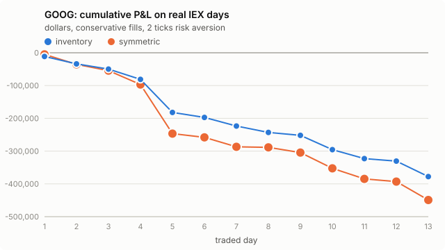

# GOOG: Avellaneda-Stoikov on real IEX data, day by day

- Traded days: 13 (2026-10-02 to 2026-10-21)
- Calibration-only days: 2; days without IEX data: 0

- IEX only: Alpaca's free plan carries the IEX exchange's own quotes and trades, a few percent of US volume. The strategy is simulated as if it quoted on IEX alone.
- No queue position: IEX data has the best bid and ask, not the order-by-order book. The conservative rule fills a quote only on a trade through its price; the optimistic rule also on a trade at it. The truth lies between the two.
- Calibrated on earlier days only (up to five). The first day of each stock only calibrates.
- P&L is in dollars, one lot of 100 shares per side, 30-minute windows that each start and end flat at the mid, before fees and rebates.

## Headline

Inventory strategy, risk aversion 2 ticks per lot.

- **conservative**: mean daily P&L -29058.90 [-43971.46, -18454.44] dollars (negative); 0 of 13 days positive; 2240 fills a day; 5 s markout -28.875 [-33.859, -23.779] ticks per fill (negative is against us).
- **optimistic**: mean daily P&L -29476.66 [-44566.14, -18873.75] dollars (negative); 0 of 13 days positive; 2334 fills a day; 5 s markout -28.316 [-33.248, -23.284] ticks per fill (negative is against us).

## Every setting

Mean over days, 95% bootstrap interval over days in brackets.

| rule | strategy | risk aversion (ticks) | daily P&L ($) | verdict | positive days | fills/day | 5 s markout (ticks) |
|---|---|---|---|---|---|---|---|
| conservative | inventory | 1 | -30485.34 [-48494.38, -18144.51] | negative | 0/13 | 2233 | -28.571 [-33.481, -23.573] |
| conservative | symmetric | 1 | -34782.83 [-58469.23, -18435.18] | negative | 0/13 | 2208 | -27.774 [-32.519, -22.837] |
| conservative | inventory | 2 | -29058.90 [-43971.46, -18454.44] | negative | 0/13 | 2240 | -28.875 [-33.859, -23.779] |
| conservative | symmetric | 2 | -34550.56 [-58178.44, -18273.28] | negative | 0/13 | 2189 | -27.872 [-32.597, -22.916] |
| conservative | inventory | 4 | -27256.92 [-38864.05, -18538.35] | negative | 0/13 | 2205 | -29.385 [-34.356, -24.222] |
| conservative | symmetric | 4 | -34026.67 [-57684.95, -17690.84] | negative | 0/13 | 2152 | -28.066 [-32.782, -23.116] |
| optimistic | inventory | 1 | -30700.03 [-48774.43, -18357.32] | negative | 0/13 | 2327 | -27.991 [-32.929, -23.022] |
| optimistic | symmetric | 1 | -35023.37 [-59057.54, -18377.80] | negative | 0/13 | 2293 | -27.236 [-31.863, -22.417] |
| optimistic | inventory | 2 | -29476.66 [-44566.14, -18873.75] | negative | 0/13 | 2334 | -28.316 [-33.248, -23.284] |
| optimistic | symmetric | 2 | -34792.20 [-58672.07, -18187.08] | negative | 0/13 | 2272 | -27.341 [-31.972, -22.507] |
| optimistic | inventory | 4 | -27597.53 [-39247.05, -18885.77] | negative | 0/13 | 2299 | -28.798 [-33.670, -23.763] |
| optimistic | symmetric | 4 | -34380.93 [-57983.73, -17973.90] | negative | 0/13 | 2228 | -27.543 [-32.202, -22.714] |

## Does inventory control help?

Daily P&L of the inventory strategy minus the symmetric one, paired by day.

| rule | risk aversion (ticks) | inventory minus symmetric ($/day) | verdict |
|---|---|---|---|
| conservative | 1 | 4297.49 [-310.10, 10265.72] | not established |
| conservative | 2 | 5491.66 [-1426.32, 14374.50] | not established |
| conservative | 4 | 6769.75 [-2040.40, 18933.35] | not established |
| optimistic | 1 | 4323.34 [-531.87, 10541.53] | not established |
| optimistic | 2 | 5315.54 [-1859.38, 14361.92] | not established |
| optimistic | 4 | 6783.40 [-2194.36, 19055.28] | not established |

## Day by day

Inventory strategy at 2 ticks.

| date | sigma ($/sqrt s) | A / k (conservative) | P&L conservative ($) | P&L optimistic ($) | fills (cons.) | 5 s markout (ticks, cons.) | IEX data |
|---|---|---|---|---|---|---|---|
| 2026-10-01 | calibration only |  |  |  |  |  | no earlier day to calibrate on; this day only calibrates |
| 2026-10-02 | 0.06399 | 0.1467 / 15.3 | -11239.88 | -11388.79 | 2611 | -14.894 | 100% quoted, 6767 trades |
| 2026-10-05 | 0.06162 | 0.1095 / 12.5 | -22660.49 | -22799.99 | 2604 | -17.254 | 100% quoted, 9105 trades |
| 2026-10-06 | 0.05802 | 0.1063 / 11.7 | -15860.42 | -16278.82 | 2137 | -16.669 | 100% quoted, 5468 trades |
| 2026-10-07 | 0.05532 | 0.0954 / 10.7 | -31484.55 | -31831.84 | 2531 | -28.992 | 100% quoted, 6416 trades |
| 2026-10-08 | 0.06492 | 0.0900 / 9.8 | -100703.35 | -101842.43 | 3797 | -34.179 | 100% quoted, 7026 trades |
| 2026-10-09 | 0.07586 | 0.0759 / 6.7 | -15241.87 | -16035.32 | 2180 | -26.736 | 100% quoted, 6154 trades |
| 2026-10-12 | 0.08256 | 0.0739 / 6.1 | -26412.27 | -26445.74 | 1682 | -34.199 | 100% quoted, 4728 trades |
| 2026-10-13 | calibration only |  |  |  |  |  | no earlier day to calibrate on; this day only calibrates |
| 2026-10-14 | 0.09808 | 0.0677 / 4.8 | -19385.65 | -20284.38 | 2738 | -22.659 | 100% quoted, 8865 trades |
| 2026-10-15 | 0.09592 | 0.0710 / 4.4 | -8858.35 | -9745.90 | 1481 | -31.364 | 100% quoted, 8160 trades |
| 2026-10-16 | 0.08691 | 0.0722 / 5.4 | -43782.76 | -44302.42 | 1600 | -44.858 | 100% quoted, 5455 trades |
| 2026-10-19 | 0.09084 | 0.0722 / 5.5 | -27282.03 | -27296.19 | 2210 | -31.606 | 100% quoted, 8489 trades |
| 2026-10-20 | 0.08560 | 0.0785 / 5.9 | -7612.79 | -7549.54 | 1130 | -29.259 | 100% quoted, 5946 trades |
| 2026-10-21 | 0.07767 | 0.0768 / 6.5 | -47241.28 | -47395.18 | 2420 | -42.704 | 100% quoted, 13763 trades |
