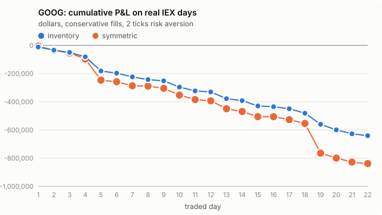

# GOOG: Avellaneda-Stoikov on real IEX data, day by day

- Traded days: 30 (2026-10-02 to 2026-11-13)
- Calibration-only days: 2; days without IEX data: 0

- IEX only: Alpaca's free plan carries the IEX exchange's own quotes and trades, a few percent of US volume. The strategy is simulated as if it quoted on IEX alone.
- No queue position: IEX data has the best bid and ask, not the order-by-order book. The conservative rule fills a quote only on a trade through its price; the optimistic rule also on a trade at it. The truth lies between the two.
- Calibrated on earlier days only (up to five). The first day of each stock only calibrates.
- P&L is in dollars, one lot of 100 shares per side, 30-minute windows that each start and end flat at the mid, before fees and rebates.

## Headline

Inventory strategy, risk aversion 2 ticks per lot.

- **conservative**: mean daily P&L -34324.91 [-45626.19, -25680.64] dollars (negative); 0 of 30 days positive; 3264 fills a day; 5 s markout -27.474 [-31.182, -23.796] ticks per fill (negative is against us).
- **optimistic**: mean daily P&L -34663.06 [-46037.41, -25937.89] dollars (negative); 0 of 30 days positive; 3458 fills a day; 5 s markout -26.597 [-30.246, -23.055] ticks per fill (negative is against us).

## Every setting

Mean over days, 95% bootstrap interval over days in brackets.

| rule | strategy | risk aversion (ticks) | daily P&L ($) | verdict | positive days | fills/day | 5 s markout (ticks) |
|---|---|---|---|---|---|---|---|
| conservative | inventory | 1 | -35382.09 [-47330.26, -25926.57] | negative | 0/30 | 3275 | -27.325 [-31.027, -23.656] |
| conservative | symmetric | 1 | -38925.57 [-58167.74, -24024.53] | negative | 1/30 | 3192 | -26.886 [-30.694, -23.248] |
| conservative | inventory | 2 | -34324.91 [-45626.19, -25680.64] | negative | 0/30 | 3264 | -27.474 [-31.182, -23.796] |
| conservative | symmetric | 2 | -38436.98 [-57385.96, -23699.88] | negative | 1/30 | 3149 | -27.080 [-30.898, -23.406] |
| conservative | inventory | 4 | -32675.23 [-43168.39, -24863.37] | negative | 0/30 | 3159 | -27.950 [-31.671, -24.277] |
| conservative | symmetric | 4 | -37891.80 [-56890.50, -23171.37] | negative | 1/30 | 3071 | -27.455 [-31.339, -23.752] |
| optimistic | inventory | 1 | -35643.00 [-47690.33, -26212.88] | negative | 0/30 | 3479 | -26.387 [-30.025, -22.822] |
| optimistic | symmetric | 1 | -39413.16 [-58904.16, -24262.91] | negative | 2/30 | 3381 | -25.978 [-29.601, -22.457] |
| optimistic | inventory | 2 | -34663.06 [-46037.41, -25937.89] | negative | 0/30 | 3458 | -26.597 [-30.246, -23.055] |
| optimistic | symmetric | 2 | -39122.63 [-58601.30, -23915.90] | negative | 1/30 | 3329 | -26.193 [-29.847, -22.669] |
| optimistic | inventory | 4 | -33061.56 [-43608.29, -25206.73] | negative | 0/30 | 3357 | -26.976 [-30.607, -23.429] |
| optimistic | symmetric | 4 | -38394.84 [-57573.06, -23506.85] | negative | 1/30 | 3236 | -26.612 [-30.385, -23.014] |

## Does inventory control help?

Daily P&L of the inventory strategy minus the symmetric one, paired by day.

| rule | risk aversion (ticks) | inventory minus symmetric ($/day) | verdict |
|---|---|---|---|
| conservative | 1 | 3543.49 [-4420.41, 14265.61] | not established |
| conservative | 2 | 4112.07 [-4499.27, 15747.24] | not established |
| conservative | 4 | 5216.57 [-4368.67, 17999.12] | not established |
| optimistic | 1 | 3770.15 [-4547.19, 14945.05] | not established |
| optimistic | 2 | 4459.57 [-4606.92, 16557.97] | not established |
| optimistic | 4 | 5333.28 [-4376.18, 18281.68] | not established |

## Day by day

Inventory strategy at 2 ticks.

| date | sigma ($/sqrt s) | A / k (conservative) | P&L conservative ($) | P&L optimistic ($) | fills (cons.) | 5 s markout (ticks, cons.) | IEX data |
|---|---|---|---|---|---|---|---|
| 2026-10-01 | calibration only |  |  |  |  |  | no earlier day to calibrate on; this day only calibrates |
| 2026-10-02 | 0.06399 | 0.1467 / 15.3 | -11239.88 | -11388.79 | 2611 | -14.894 | 100% quoted, 6767 trades |
| 2026-10-05 | 0.06162 | 0.1095 / 12.5 | -22660.49 | -22799.99 | 2604 | -17.254 | 100% quoted, 9105 trades |
| 2026-10-06 | 0.05802 | 0.1063 / 11.7 | -15860.42 | -16278.82 | 2137 | -16.669 | 100% quoted, 5468 trades |
| 2026-10-07 | 0.05532 | 0.0954 / 10.7 | -31484.55 | -31831.84 | 2531 | -28.992 | 100% quoted, 6416 trades |
| 2026-10-08 | 0.06492 | 0.0900 / 9.8 | -100703.35 | -101842.43 | 3797 | -34.179 | 100% quoted, 7026 trades |
| 2026-10-09 | 0.07586 | 0.0759 / 6.7 | -15241.87 | -16035.32 | 2180 | -26.736 | 100% quoted, 6154 trades |
| 2026-10-12 | 0.08256 | 0.0739 / 6.1 | -26412.27 | -26445.74 | 1682 | -34.199 | 100% quoted, 4728 trades |
| 2026-10-13 | calibration only |  |  |  |  |  | no earlier day to calibrate on; this day only calibrates |
| 2026-10-14 | 0.09808 | 0.0677 / 4.8 | -19385.65 | -20284.38 | 2738 | -22.659 | 100% quoted, 8865 trades |
| 2026-10-15 | 0.09592 | 0.0710 / 4.4 | -8858.35 | -9745.90 | 1481 | -31.364 | 100% quoted, 8160 trades |
| 2026-10-16 | 0.08691 | 0.0722 / 5.4 | -43782.76 | -44302.42 | 1600 | -44.858 | 100% quoted, 5455 trades |
| 2026-10-19 | 0.09084 | 0.0722 / 5.5 | -27282.03 | -27296.19 | 2210 | -31.606 | 100% quoted, 8489 trades |
| 2026-10-20 | 0.08560 | 0.0785 / 5.9 | -7612.79 | -7549.54 | 1130 | -29.259 | 100% quoted, 5946 trades |
| 2026-10-21 | 0.07767 | 0.0768 / 6.5 | -47241.28 | -47395.18 | 2420 | -42.704 | 100% quoted, 13763 trades |
| 2026-10-22 | 0.07724 | 0.0850 / 8.0 | -14284.81 | -14767.99 | 1900 | -20.943 | 100% quoted, 13497 trades |
| 2026-10-23 | 0.07514 | 0.0958 / 9.9 | -37735.46 | -37867.06 | 1686 | -53.034 | 100% quoted, 7250 trades |
| 2026-10-26 | 0.07559 | 0.0996 / 11.0 | -5240.29 | -5308.07 | 1040 | -19.956 | 100% quoted, 9506 trades |
| 2026-10-27 | 0.07083 | 0.1011 / 13.5 | -14483.97 | -14641.41 | 1896 | -22.055 | 100% quoted, 12353 trades |
| 2026-10-28 | 0.07165 | 0.1110 / 15.2 | -31726.94 | -31676.03 | 2827 | -37.105 | 100% quoted, 14360 trades |
| 2026-10-29 | 0.06874 | 0.1113 / 17.1 | -78447.10 | -78681.18 | 11138 | -15.240 | 100% quoted, 54450 trades |
| 2026-10-30 | 0.07053 | 0.1515 / 16.2 | -39931.14 | -40085.30 | 9481 | -14.111 | 100% quoted, 22459 trades |
| 2026-11-02 | 0.05372 | 0.1789 / 13.8 | -27436.51 | -27646.05 | 3357 | -24.125 | 100% quoted, 14707 trades |
| 2026-11-03 | 0.05796 | 0.1885 / 13.5 | -13817.08 | -13773.35 | 1798 | -26.543 | 100% quoted, 11721 trades |
| 2026-11-04 | 0.05592 | 0.1876 / 13.6 | -27997.24 | -28948.83 | 5549 | -23.177 | 100% quoted, 20045 trades |
| 2026-11-05 | 0.05309 | 0.1942 / 12.8 | -135518.99 | -136168.92 | 6852 | -44.736 | 100% quoted, 21473 trades |
| 2026-11-06 | 0.06552 | 0.1636 / 11.2 | -53632.78 | -53471.79 | 2571 | -45.366 | 100% quoted, 10795 trades |
| 2026-11-09 | 0.07127 | 0.1425 / 13.2 | -34997.31 | -35127.24 | 3776 | -17.760 | 100% quoted, 14482 trades |
| 2026-11-10 | 0.07227 | 0.1397 / 11.9 | -39429.17 | -39506.73 | 4476 | -22.864 | 100% quoted, 11153 trades |
| 2026-11-11 | 0.07838 | 0.1387 / 9.4 | -22274.87 | -22434.01 | 2598 | -16.683 | 100% quoted, 14215 trades |
| 2026-11-12 | 0.07707 | 0.1302 / 9.4 | -31153.76 | -31172.15 | 4227 | -20.975 | 100% quoted, 15450 trades |
| 2026-11-13 | 0.06975 | 0.1167 / 8.6 | -43874.19 | -45419.14 | 3613 | -24.181 | 100% quoted, 11223 trades |
