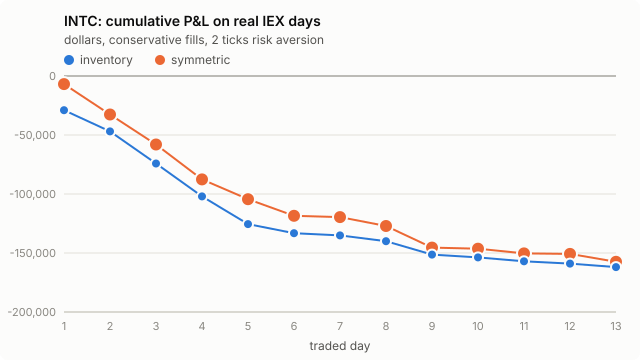

# INTC: Avellaneda-Stoikov on real IEX data, day by day

- Traded days: 9 (2026-10-02 to 2026-10-15)
- Calibration-only days: 2; days without IEX data: 0

- IEX only: Alpaca's free plan carries the IEX exchange's own quotes and trades, a few percent of US volume. The strategy is simulated as if it quoted on IEX alone.
- No queue position: IEX data has the best bid and ask, not the order-by-order book. The conservative rule fills a quote only on a trade through its price; the optimistic rule also on a trade at it. The truth lies between the two.
- Calibrated on earlier days only (up to five). The first day of each stock only calibrates.
- P&L is in dollars, one lot of 100 shares per side, 30-minute windows that each start and end flat at the mid, before fees and rebates.

## Headline

Inventory strategy, risk aversion 2 ticks per lot.

- **conservative**: mean daily P&L -16813.64 [-23289.56, -10142.00] dollars (negative); 0 of 9 days positive; 2188 fills a day; 5 s markout -13.667 [-15.839, -11.171] ticks per fill (negative is against us).
- **optimistic**: mean daily P&L -17519.09 [-24238.58, -10701.35] dollars (negative); 0 of 9 days positive; 3022 fills a day; 5 s markout -10.678 [-12.891, -8.177] ticks per fill (negative is against us).

## Every setting

Mean over days, 95% bootstrap interval over days in brackets.

| rule | strategy | risk aversion (ticks) | daily P&L ($) | verdict | positive days | fills/day | 5 s markout (ticks) |
|---|---|---|---|---|---|---|---|
| conservative | inventory | 1 | -17180.06 [-23539.25, -10710.69] | negative | 0/9 | 2208 | -13.698 [-16.003, -11.076] |
| conservative | symmetric | 1 | -16768.38 [-22366.88, -10740.87] | negative | 0/9 | 1993 | -14.743 [-17.335, -11.882] |
| conservative | inventory | 2 | -16813.64 [-23289.56, -10142.00] | negative | 0/9 | 2188 | -13.667 [-15.839, -11.171] |
| conservative | symmetric | 2 | -16159.51 [-21758.41, -10075.12] | negative | 0/9 | 1892 | -15.312 [-17.896, -12.494] |
| conservative | inventory | 4 | -16098.22 [-22463.13, -9650.74] | negative | 0/9 | 2106 | -13.854 [-16.045, -11.433] |
| conservative | symmetric | 4 | -15496.19 [-20925.58, -9648.00] | negative | 0/9 | 1733 | -16.316 [-18.874, -13.586] |
| optimistic | inventory | 1 | -17919.54 [-24610.64, -11046.21] | negative | 0/9 | 3105 | -10.604 [-12.907, -8.041] |
| optimistic | symmetric | 1 | -17789.95 [-23528.16, -11165.45] | negative | 1/9 | 2850 | -11.296 [-13.702, -8.555] |
| optimistic | inventory | 2 | -17519.09 [-24238.58, -10701.35] | negative | 0/9 | 3022 | -10.678 [-12.891, -8.177] |
| optimistic | symmetric | 2 | -17415.90 [-23035.66, -10953.94] | negative | 0/9 | 2638 | -11.957 [-14.456, -9.159] |
| optimistic | inventory | 4 | -16783.04 [-23353.28, -10073.97] | negative | 0/9 | 2859 | -10.900 [-13.064, -8.489] |
| optimistic | symmetric | 4 | -16735.89 [-22215.96, -10687.42] | negative | 0/9 | 2321 | -13.062 [-15.629, -10.198] |

## Does inventory control help?

Daily P&L of the inventory strategy minus the symmetric one, paired by day.

| rule | risk aversion (ticks) | inventory minus symmetric ($/day) | verdict |
|---|---|---|---|
| conservative | 1 | -411.68 [-6398.59, 4173.98] | not established |
| conservative | 2 | -654.14 [-7249.62, 4146.93] | not established |
| conservative | 4 | -602.03 [-7097.83, 4062.63] | not established |
| optimistic | 1 | -129.59 [-6266.03, 5097.46] | not established |
| optimistic | 2 | -103.19 [-6775.57, 5206.06] | not established |
| optimistic | 4 | -47.15 [-6604.94, 5278.04] | not established |

## Day by day

Inventory strategy at 2 ticks.

| date | sigma ($/sqrt s) | A / k (conservative) | P&L conservative ($) | P&L optimistic ($) | fills (cons.) | 5 s markout (ticks, cons.) | IEX data |
|---|---|---|---|---|---|---|---|
| 2026-10-01 | calibration only |  |  |  |  |  | no earlier day to calibrate on; this day only calibrates |
| 2026-10-02 | 0.03676 | 0.2096 / 37.8 | -28953.32 | -29533.70 | 3512 | -14.048 | 100% quoted, 20263 trades |
| 2026-10-05 | 0.03458 | 0.1827 / 31.7 | -17982.03 | -18514.21 | 1813 | -16.001 | 100% quoted, 20854 trades |
| 2026-10-06 | 0.03036 | 0.1596 / 32.3 | -27199.84 | -28277.24 | 3107 | -16.738 | 100% quoted, 22050 trades |
| 2026-10-07 | 0.03001 | 0.1545 / 29.8 | -27924.08 | -29077.36 | 2894 | -16.887 | 100% quoted, 17100 trades |
| 2026-10-08 | 0.02992 | 0.1466 / 28.0 | -23440.90 | -24950.76 | 3028 | -15.149 | 100% quoted, 31296 trades |
| 2026-10-09 | 0.02858 | 0.1431 / 27.1 | -7686.91 | -8454.60 | 955 | -17.342 | 100% quoted, 26508 trades |
| 2026-10-12 | 0.02711 | 0.1370 / 30.3 | -1917.16 | -2162.12 | 416 | -10.779 | 100% quoted, 23043 trades |
| 2026-10-13 | calibration only |  |  |  |  |  | no earlier day to calibrate on; this day only calibrates |
| 2026-10-14 | 0.02428 | 0.1408 / 41.0 | -4865.53 | -4946.51 | 1074 | -8.365 | 100% quoted, 29449 trades |
| 2026-10-15 | 0.02192 | 0.1576 / 52.1 | -11353.03 | -11755.31 | 2895 | -7.699 | 100% quoted, 36726 trades |
