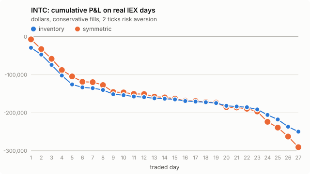

# INTC: Avellaneda-Stoikov on real IEX data, day by day

- Traded days: 21 (2026-10-02 to 2026-11-02)
- Calibration-only days: 2; days without IEX data: 0

- IEX only: Alpaca's free plan carries the IEX exchange's own quotes and trades, a few percent of US volume. The strategy is simulated as if it quoted on IEX alone.
- No queue position: IEX data has the best bid and ask, not the order-by-order book. The conservative rule fills a quote only on a trade through its price; the optimistic rule also on a trade at it. The truth lies between the two.
- Calibrated on earlier days only (up to five). The first day of each stock only calibrates.
- P&L is in dollars, one lot of 100 shares per side, 30-minute windows that each start and end flat at the mid, before fees and rebates.

## Headline

Inventory strategy, risk aversion 2 ticks per lot.

- **conservative**: mean daily P&L -8742.89 [-13170.44, -4929.71] dollars (negative); 0 of 21 days positive; 1906 fills a day; 5 s markout -8.137 [-10.576, -5.828] ticks per fill (negative is against us).
- **optimistic**: mean daily P&L -8903.07 [-13489.12, -4808.60] dollars (negative); 0 of 21 days positive; 3031 fills a day; 5 s markout -6.218 [-8.299, -4.304] ticks per fill (negative is against us).

## Every setting

Mean over days, 95% bootstrap interval over days in brackets.

| rule | strategy | risk aversion (ticks) | daily P&L ($) | verdict | positive days | fills/day | 5 s markout (ticks) |
|---|---|---|---|---|---|---|---|
| conservative | inventory | 1 | -9053.72 [-13449.38, -5202.92] | negative | 0/21 | 2003 | -8.126 [-10.592, -5.770] |
| conservative | symmetric | 1 | -9339.77 [-13517.46, -5709.62] | negative | 0/21 | 1851 | -8.720 [-11.377, -6.178] |
| conservative | inventory | 2 | -8742.89 [-13170.44, -4929.71] | negative | 0/21 | 1906 | -8.137 [-10.576, -5.828] |
| conservative | symmetric | 2 | -8862.40 [-13010.66, -5232.68] | negative | 0/21 | 1663 | -9.154 [-11.836, -6.577] |
| conservative | inventory | 4 | -8223.74 [-12544.30, -4464.33] | negative | 0/21 | 1705 | -8.327 [-10.732, -6.050] |
| conservative | symmetric | 4 | -8291.47 [-12372.17, -4669.10] | negative | 1/21 | 1377 | -9.915 [-12.688, -7.275] |
| optimistic | inventory | 1 | -9220.50 [-13840.15, -5116.84] | negative | 0/21 | 3283 | -6.131 [-8.241, -4.189] |
| optimistic | symmetric | 1 | -10153.42 [-14451.26, -6150.75] | negative | 3/21 | 3076 | -6.561 [-8.772, -4.502] |
| optimistic | inventory | 2 | -8903.07 [-13489.12, -4808.60] | negative | 0/21 | 3031 | -6.218 [-8.299, -4.304] |
| optimistic | symmetric | 2 | -9613.04 [-13880.35, -5861.90] | negative | 0/21 | 2669 | -7.026 [-9.314, -4.878] |
| optimistic | inventory | 4 | -8441.56 [-12902.29, -4501.35] | negative | 0/21 | 2650 | -6.394 [-8.459, -4.466] |
| optimistic | symmetric | 4 | -9051.65 [-13330.41, -5281.93] | negative | 1/21 | 2129 | -7.771 [-10.198, -5.496] |

## Does inventory control help?

Daily P&L of the inventory strategy minus the symmetric one, paired by day.

| rule | risk aversion (ticks) | inventory minus symmetric ($/day) | verdict |
|---|---|---|---|
| conservative | 1 | 286.05 [-2448.87, 2419.17] | not established |
| conservative | 2 | 119.51 [-2837.79, 2365.29] | not established |
| conservative | 4 | 67.73 [-2888.48, 2387.63] | not established |
| optimistic | 1 | 932.93 [-2002.96, 3460.76] | not established |
| optimistic | 2 | 709.96 [-2262.46, 3197.19] | not established |
| optimistic | 4 | 610.09 [-2403.14, 3164.37] | not established |

## Day by day

Inventory strategy at 2 ticks.

| date | sigma ($/sqrt s) | A / k (conservative) | P&L conservative ($) | P&L optimistic ($) | fills (cons.) | 5 s markout (ticks, cons.) | IEX data |
|---|---|---|---|---|---|---|---|
| 2026-10-01 | calibration only |  |  |  |  |  | no earlier day to calibrate on; this day only calibrates |
| 2026-10-02 | 0.03676 | 0.2096 / 37.8 | -28953.32 | -29533.70 | 3512 | -14.048 | 100% quoted, 20263 trades |
| 2026-10-05 | 0.03458 | 0.1827 / 31.7 | -17982.03 | -18514.21 | 1813 | -16.001 | 100% quoted, 20854 trades |
| 2026-10-06 | 0.03036 | 0.1596 / 32.3 | -27199.84 | -28277.24 | 3107 | -16.738 | 100% quoted, 22050 trades |
| 2026-10-07 | 0.03001 | 0.1545 / 29.8 | -27924.08 | -29077.36 | 2894 | -16.887 | 100% quoted, 17100 trades |
| 2026-10-08 | 0.02992 | 0.1466 / 28.0 | -23440.90 | -24950.76 | 3028 | -15.149 | 100% quoted, 31296 trades |
| 2026-10-09 | 0.02858 | 0.1431 / 27.1 | -7686.91 | -8454.60 | 955 | -17.342 | 100% quoted, 26508 trades |
| 2026-10-12 | 0.02711 | 0.1370 / 30.3 | -1917.16 | -2162.12 | 416 | -10.779 | 100% quoted, 23043 trades |
| 2026-10-13 | calibration only |  |  |  |  |  | no earlier day to calibrate on; this day only calibrates |
| 2026-10-14 | 0.02428 | 0.1408 / 41.0 | -4865.53 | -4946.51 | 1074 | -8.365 | 100% quoted, 29449 trades |
| 2026-10-15 | 0.02192 | 0.1576 / 52.1 | -11353.03 | -11755.31 | 2895 | -7.699 | 100% quoted, 36726 trades |
| 2026-10-16 | 0.01975 | 0.1645 / 58.1 | -2421.01 | -2074.86 | 1261 | -3.846 | 100% quoted, 29908 trades |
| 2026-10-19 | 0.01801 | 0.1773 / 63.7 | -3319.80 | -3140.96 | 1329 | -5.225 | 100% quoted, 29649 trades |
| 2026-10-20 | 0.01869 | 0.1856 / 64.1 | -1897.85 | -1351.64 | 1595 | -3.741 | 100% quoted, 32079 trades |
| 2026-10-21 | 0.01889 | 0.1903 / 66.1 | -3012.00 | -3003.82 | 1399 | -5.246 | 100% quoted, 31948 trades |
| 2026-10-22 | 0.01853 | 0.1862 / 67.3 | -1056.44 | -808.99 | 1498 | -3.340 | 100% quoted, 43100 trades |
| 2026-10-23 | 0.01691 | 0.1965 / 80.5 | -1805.13 | -1736.00 | 1219 | -3.620 | 100% quoted, 19398 trades |
| 2026-10-26 | 0.01655 | 0.1805 / 79.5 | -4205.08 | -3719.41 | 1527 | -4.902 | 100% quoted, 27865 trades |
| 2026-10-27 | 0.01603 | 0.1811 / 80.2 | -1610.63 | -1421.46 | 1201 | -3.529 | 100% quoted, 29939 trades |
| 2026-10-28 | 0.01554 | 0.1746 / 81.5 | -1609.92 | -1489.04 | 1402 | -3.809 | 100% quoted, 25497 trades |
| 2026-10-29 | 0.01587 | 0.1719 / 83.1 | -2175.55 | -1877.81 | 1219 | -3.584 | 100% quoted, 25844 trades |
| 2026-10-30 | 0.01603 | 0.1566 / 82.0 | -7243.08 | -6716.97 | 4953 | -3.866 | 100% quoted, 124834 trades |
| 2026-11-02 | 0.01702 | 0.2122 / 75.7 | -1921.44 | -1951.75 | 1723 | -3.155 | 100% quoted, 66803 trades |
