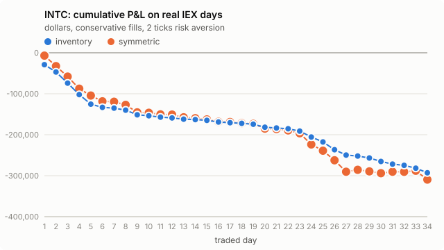

# INTC: Avellaneda-Stoikov on real IEX data, day by day

- Traded days: 35 (2026-10-02 to 2026-11-20)
- Calibration-only days: 2; days without IEX data: 0

- IEX only: Alpaca's free plan carries the IEX exchange's own quotes and trades, a few percent of US volume. The strategy is simulated as if it quoted on IEX alone.
- No queue position: IEX data has the best bid and ask, not the order-by-order book. The conservative rule fills a quote only on a trade through its price; the optimistic rule also on a trade at it. The truth lies between the two.
- Calibrated on earlier days only (up to five). The first day of each stock only calibrates.
- P&L is in dollars, one lot of 100 shares per side, 30-minute windows that each start and end flat at the mid, before fees and rebates.

## Headline

Inventory strategy, risk aversion 2 ticks per lot.

- **conservative**: mean daily P&L -8510.45 [-11343.52, -5972.75] dollars (negative); 0 of 35 days positive; 1883 fills a day; 5 s markout -8.045 [-9.735, -6.547] ticks per fill (negative is against us).
- **optimistic**: mean daily P&L -8539.79 [-11493.10, -5892.14] dollars (negative); 0 of 35 days positive; 3079 fills a day; 5 s markout -5.855 [-7.210, -4.628] ticks per fill (negative is against us).

## Every setting

Mean over days, 95% bootstrap interval over days in brackets.

| rule | strategy | risk aversion (ticks) | daily P&L ($) | verdict | positive days | fills/day | 5 s markout (ticks) |
|---|---|---|---|---|---|---|---|
| conservative | inventory | 1 | -8922.52 [-11771.58, -6353.09] | negative | 0/35 | 2004 | -7.931 [-9.631, -6.425] |
| conservative | symmetric | 1 | -9431.76 [-12905.21, -6192.25] | negative | 3/35 | 1870 | -8.400 [-10.208, -6.764] |
| conservative | inventory | 2 | -8510.45 [-11343.52, -5972.75] | negative | 0/35 | 1883 | -8.045 [-9.735, -6.547] |
| conservative | symmetric | 2 | -8985.67 [-12416.02, -5784.25] | negative | 3/35 | 1656 | -8.998 [-10.882, -7.303] |
| conservative | inventory | 4 | -7961.45 [-10693.12, -5501.04] | negative | 0/35 | 1655 | -8.430 [-10.166, -6.900] |
| conservative | symmetric | 4 | -8492.42 [-11767.13, -5510.70] | negative | 4/35 | 1347 | -10.026 [-12.034, -8.204] |
| optimistic | inventory | 1 | -8922.72 [-11973.90, -6261.75] | negative | 0/35 | 3366 | -5.689 [-7.034, -4.465] |
| optimistic | symmetric | 1 | -9837.97 [-13677.24, -6246.83] | negative | 8/35 | 3172 | -6.048 [-7.503, -4.755] |
| optimistic | inventory | 2 | -8539.79 [-11493.10, -5892.14] | negative | 0/35 | 3079 | -5.855 [-7.210, -4.628] |
| optimistic | symmetric | 2 | -9421.78 [-13129.76, -5914.74] | negative | 5/35 | 2732 | -6.581 [-8.126, -5.223] |
| optimistic | inventory | 4 | -8041.92 [-10904.40, -5501.03] | negative | 0/35 | 2639 | -6.198 [-7.561, -4.940] |
| optimistic | symmetric | 4 | -8851.57 [-12348.81, -5623.54] | negative | 4/35 | 2142 | -7.486 [-9.108, -6.005] |

## Does inventory control help?

Daily P&L of the inventory strategy minus the symmetric one, paired by day.

| rule | risk aversion (ticks) | inventory minus symmetric ($/day) | verdict |
|---|---|---|---|
| conservative | 1 | 509.24 [-1690.33, 2593.96] | not established |
| conservative | 2 | 475.22 [-1852.78, 2561.58] | not established |
| conservative | 4 | 530.98 [-1697.44, 2596.71] | not established |
| optimistic | 1 | 915.25 [-1565.88, 3323.95] | not established |
| optimistic | 2 | 881.99 [-1585.89, 3244.83] | not established |
| optimistic | 4 | 809.65 [-1447.40, 3000.92] | not established |

## Day by day

Inventory strategy at 2 ticks.

| date | sigma ($/sqrt s) | A / k (conservative) | P&L conservative ($) | P&L optimistic ($) | fills (cons.) | 5 s markout (ticks, cons.) | IEX data |
|---|---|---|---|---|---|---|---|
| 2026-10-01 | calibration only |  |  |  |  |  | no earlier day to calibrate on; this day only calibrates |
| 2026-10-02 | 0.03676 | 0.2096 / 37.8 | -28953.32 | -29533.70 | 3512 | -14.048 | 100% quoted, 20263 trades |
| 2026-10-05 | 0.03458 | 0.1827 / 31.7 | -17982.03 | -18514.21 | 1813 | -16.001 | 100% quoted, 20854 trades |
| 2026-10-06 | 0.03036 | 0.1596 / 32.3 | -27199.84 | -28277.24 | 3107 | -16.738 | 100% quoted, 22050 trades |
| 2026-10-07 | 0.03001 | 0.1545 / 29.8 | -27924.08 | -29077.36 | 2894 | -16.887 | 100% quoted, 17100 trades |
| 2026-10-08 | 0.02992 | 0.1466 / 28.0 | -23440.90 | -24950.76 | 3028 | -15.149 | 100% quoted, 31296 trades |
| 2026-10-09 | 0.02858 | 0.1431 / 27.1 | -7686.91 | -8454.60 | 955 | -17.342 | 100% quoted, 26508 trades |
| 2026-10-12 | 0.02711 | 0.1370 / 30.3 | -1917.16 | -2162.12 | 416 | -10.779 | 100% quoted, 23043 trades |
| 2026-10-13 | calibration only |  |  |  |  |  | no earlier day to calibrate on; this day only calibrates |
| 2026-10-14 | 0.02428 | 0.1408 / 41.0 | -4865.53 | -4946.51 | 1074 | -8.365 | 100% quoted, 29449 trades |
| 2026-10-15 | 0.02192 | 0.1576 / 52.1 | -11353.03 | -11755.31 | 2895 | -7.699 | 100% quoted, 36726 trades |
| 2026-10-16 | 0.01975 | 0.1645 / 58.1 | -2421.01 | -2074.86 | 1261 | -3.846 | 100% quoted, 29908 trades |
| 2026-10-19 | 0.01801 | 0.1773 / 63.7 | -3319.80 | -3140.96 | 1329 | -5.225 | 100% quoted, 29649 trades |
| 2026-10-20 | 0.01869 | 0.1856 / 64.1 | -1897.85 | -1351.64 | 1595 | -3.741 | 100% quoted, 32079 trades |
| 2026-10-21 | 0.01889 | 0.1903 / 66.1 | -3012.00 | -3003.82 | 1399 | -5.246 | 100% quoted, 31948 trades |
| 2026-10-22 | 0.01853 | 0.1862 / 67.3 | -1056.44 | -808.99 | 1498 | -3.340 | 100% quoted, 43100 trades |
| 2026-10-23 | 0.01691 | 0.1965 / 80.5 | -1805.13 | -1736.00 | 1219 | -3.620 | 100% quoted, 19398 trades |
| 2026-10-26 | 0.01655 | 0.1805 / 79.5 | -4205.08 | -3719.41 | 1527 | -4.902 | 100% quoted, 27865 trades |
| 2026-10-27 | 0.01603 | 0.1811 / 80.2 | -1610.63 | -1421.46 | 1201 | -3.529 | 100% quoted, 29939 trades |
| 2026-10-28 | 0.01554 | 0.1746 / 81.5 | -1609.92 | -1489.04 | 1402 | -3.809 | 100% quoted, 25497 trades |
| 2026-10-29 | 0.01587 | 0.1719 / 83.1 | -2175.55 | -1877.81 | 1219 | -3.584 | 100% quoted, 25844 trades |
| 2026-10-30 | 0.01603 | 0.1566 / 82.0 | -7243.08 | -6716.97 | 4953 | -3.866 | 100% quoted, 124834 trades |
| 2026-11-02 | 0.01702 | 0.2122 / 75.7 | -1921.44 | -1951.75 | 1723 | -3.155 | 100% quoted, 66803 trades |
| 2026-11-03 | 0.01661 | 0.2270 / 77.3 | -1838.92 | -1581.84 | 969 | -4.262 | 100% quoted, 36165 trades |
| 2026-11-04 | 0.01610 | 0.2286 / 78.3 | -5783.48 | -4897.26 | 2543 | -4.088 | 100% quoted, 54552 trades |
| 2026-11-05 | 0.01619 | 0.2514 / 76.2 | -14416.90 | -13728.45 | 4820 | -5.340 | 100% quoted, 64980 trades |
| 2026-11-06 | 0.01775 | 0.2829 / 67.4 | -11962.36 | -11880.82 | 2222 | -7.070 | 100% quoted, 38853 trades |
| 2026-11-09 | 0.01771 | 0.2366 / 64.1 | -19074.41 | -19096.07 | 1426 | -17.939 | 100% quoted, 34942 trades |
| 2026-11-10 | 0.01974 | 0.2204 / 60.4 | -12935.55 | -13002.14 | 1172 | -11.930 | 100% quoted, 18547 trades |
| 2026-11-11 | 0.02133 | 0.2121 / 57.2 | -2454.87 | -2333.88 | 878 | -5.879 | 100% quoted, 31105 trades |
| 2026-11-12 | 0.02052 | 0.1898 / 56.7 | -4658.20 | -4385.59 | 778 | -9.005 | 100% quoted, 20404 trades |
| 2026-11-13 | 0.01928 | 0.1499 / 61.6 | -8514.15 | -8562.43 | 1055 | -12.647 | 100% quoted, 21216 trades |
| 2026-11-16 | 0.01955 | 0.1365 / 66.2 | -6490.01 | -6714.84 | 996 | -9.377 | 100% quoted, 23554 trades |
| 2026-11-17 | 0.01759 | 0.1291 / 68.1 | -3020.47 | -3196.08 | 1252 | -4.986 | 100% quoted, 31244 trades |
| 2026-11-18 | 0.01658 | 0.1449 / 74.3 | -6952.31 | -7020.16 | 1509 | -8.021 | 100% quoted, 25446 trades |
| 2026-11-19 | 0.01748 | 0.1481 / 72.7 | -11244.09 | -11322.24 | 2757 | -6.462 | 100% quoted, 40883 trades |
| 2026-11-20 | 0.01903 | 0.1711 / 69.1 | -4919.38 | -4206.42 | 3496 | -3.692 | 100% quoted, 63095 trades |
