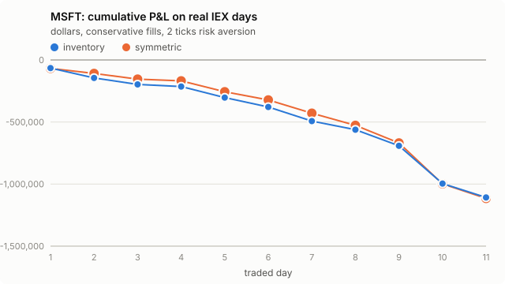

# MSFT: Avellaneda-Stoikov on real IEX data, day by day

- Traded days: 12 (2026-10-02 to 2026-10-20)
- Calibration-only days: 2; days without IEX data: 0

- IEX only: Alpaca's free plan carries the IEX exchange's own quotes and trades, a few percent of US volume. The strategy is simulated as if it quoted on IEX alone.
- No queue position: IEX data has the best bid and ask, not the order-by-order book. The conservative rule fills a quote only on a trade through its price; the optimistic rule also on a trade at it. The truth lies between the two.
- Calibrated on earlier days only (up to five). The first day of each stock only calibrates.
- P&L is in dollars, one lot of 100 shares per side, 30-minute windows that each start and end flat at the mid, before fees and rebates.

## Headline

Inventory strategy, risk aversion 2 ticks per lot.

- **conservative**: mean daily P&L -102049.87 [-145661.38, -70530.05] dollars (negative); 0 of 12 days positive; 4143 fills a day; 5 s markout -49.581 [-59.419, -41.121] ticks per fill (negative is against us).
- **optimistic**: mean daily P&L -102351.68 [-145772.84, -70883.37] dollars (negative); 0 of 12 days positive; 4325 fills a day; 5 s markout -47.942 [-57.384, -39.837] ticks per fill (negative is against us).

## Every setting

Mean over days, 95% bootstrap interval over days in brackets.

| rule | strategy | risk aversion (ticks) | daily P&L ($) | verdict | positive days | fills/day | 5 s markout (ticks) |
|---|---|---|---|---|---|---|---|
| conservative | inventory | 1 | -104144.83 [-148518.29, -71149.59] | negative | 0/12 | 4092 | -49.472 [-59.168, -41.238] |
| conservative | symmetric | 1 | -105954.21 [-155202.47, -67589.83] | negative | 0/12 | 4010 | -49.077 [-58.380, -40.981] |
| conservative | inventory | 2 | -102049.87 [-145661.38, -70530.05] | negative | 0/12 | 4143 | -49.581 [-59.419, -41.121] |
| conservative | symmetric | 2 | -105480.15 [-154715.27, -67111.31] | negative | 0/12 | 3976 | -49.351 [-58.613, -41.199] |
| conservative | inventory | 4 | -97959.45 [-140322.02, -67677.81] | negative | 0/12 | 4173 | -50.136 [-60.220, -41.509] |
| conservative | symmetric | 4 | -104904.71 [-154354.53, -66695.68] | negative | 0/12 | 3902 | -50.011 [-59.514, -41.664] |
| optimistic | inventory | 1 | -104348.11 [-148823.44, -71544.89] | negative | 0/12 | 4272 | -47.737 [-57.325, -39.809] |
| optimistic | symmetric | 1 | -106441.23 [-155991.48, -67713.11] | negative | 0/12 | 4193 | -47.304 [-56.229, -39.769] |
| optimistic | inventory | 2 | -102351.68 [-145772.84, -70883.37] | negative | 0/12 | 4325 | -47.942 [-57.384, -39.837] |
| optimistic | symmetric | 2 | -105930.84 [-155555.27, -67513.30] | negative | 0/12 | 4146 | -47.747 [-56.745, -40.096] |
| optimistic | inventory | 4 | -98120.88 [-140363.07, -67780.59] | negative | 0/12 | 4354 | -48.531 [-58.117, -40.231] |
| optimistic | symmetric | 4 | -105348.81 [-154854.42, -67158.98] | negative | 0/12 | 4065 | -48.378 [-57.516, -40.550] |

## Does inventory control help?

Daily P&L of the inventory strategy minus the symmetric one, paired by day.

| rule | risk aversion (ticks) | inventory minus symmetric ($/day) | verdict |
|---|---|---|---|
| conservative | 1 | 1809.38 [-6836.29, 9793.09] | not established |
| conservative | 2 | 3430.28 [-7371.05, 13856.95] | not established |
| conservative | 4 | 6945.26 [-5559.75, 19682.19] | not established |
| optimistic | 1 | 2093.11 [-6960.16, 10605.17] | not established |
| optimistic | 2 | 3579.15 [-7508.18, 14360.33] | not established |
| optimistic | 4 | 7227.94 [-5194.17, 19891.47] | not established |

## Day by day

Inventory strategy at 2 ticks.

| date | sigma ($/sqrt s) | A / k (conservative) | P&L conservative ($) | P&L optimistic ($) | fills (cons.) | 5 s markout (ticks, cons.) | IEX data |
|---|---|---|---|---|---|---|---|
| 2026-10-01 | calibration only |  |  |  |  |  | no earlier day to calibrate on; this day only calibrates |
| 2026-10-02 | 0.09188 | 0.1438 / 7.8 | -65274.53 | -65888.49 | 2452 | -75.700 | 100% quoted, 13763 trades |
| 2026-10-05 | 0.12604 | 0.1347 / 8.9 | -79396.69 | -80419.49 | 4148 | -41.324 | 100% quoted, 16740 trades |
| 2026-10-06 | 0.11589 | 0.1348 / 9.1 | -52361.15 | -51868.89 | 4397 | -33.239 | 100% quoted, 13695 trades |
| 2026-10-07 | 0.10694 | 0.1325 / 8.9 | -16941.47 | -17240.57 | 2370 | -29.213 | 100% quoted, 13278 trades |
| 2026-10-08 | 0.09814 | 0.1282 / 9.5 | -89481.54 | -90269.51 | 3660 | -53.834 | 100% quoted, 17122 trades |
| 2026-10-09 | 0.11259 | 0.1277 / 9.8 | -75181.24 | -75637.03 | 3752 | -44.122 | 100% quoted, 12668 trades |
| 2026-10-12 | 0.11763 | 0.1272 / 9.6 | -113648.16 | -114515.77 | 3508 | -77.494 | 100% quoted, 12123 trades |
| 2026-10-13 | calibration only |  |  |  |  |  | no earlier day to calibrate on; this day only calibrates |
| 2026-10-14 | 0.13651 | 0.1311 / 8.8 | -69596.52 | -69191.59 | 4345 | -42.767 | 100% quoted, 19532 trades |
| 2026-10-15 | 0.14547 | 0.1440 / 8.5 | -129653.63 | -129815.96 | 4768 | -43.605 | 100% quoted, 13232 trades |
| 2026-10-16 | 0.14607 | 0.1387 / 7.6 | -304716.82 | -304893.28 | 6729 | -73.847 | 100% quoted, 17571 trades |
| 2026-10-19 | 0.17502 | 0.1457 / 6.6 | -111791.66 | -111739.96 | 5452 | -42.922 | 100% quoted, 13924 trades |
| 2026-10-20 | 0.16547 | 0.1530 / 6.2 | -116555.06 | -116739.68 | 4135 | -36.905 | 100% quoted, 9975 trades |
